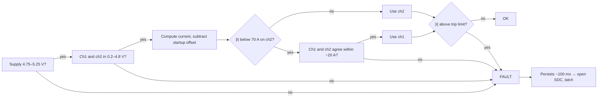

# BMS-Master

Controller board for the FSUK accumulator. Bridges to the daisy-chained
cell-monitor stack (`BMS-Module`, x6) via a BQ79600-Q1, runs the safety logic
(limit checks, SoC estimation, balancing control, fault latch), and talks two
CAN buses — full telemetry, and a summarized feed to the ECU/dashboard.

## Block diagram


- SPI to the **BQ79600-Q1 bridge** (plus `SPI_RDY` and `NFAULT` interrupts),
  reading the daisy-chained cell-monitor stack.
- Reads the accumulator **current sensor**.
- Runs **limit checks, SoC estimation, balancing control, fault latch**.
- Drives the **`AMS_OK` signal** (12 V) directly (not via CAN/ECU) to the SDC
  board, which holds the latch and relay. Low opens the SDC, in both driving
  and charging states.
- **CAN1**: full telemetry (96 cells, 192 temps, balancing state, I, V).
  **CAN2**: summarized state (SoC, max cell V, max temp, fault code) to
  ECU/dashboard.
- Drives the **isolated charger regulation bus** (opto STOP signal).
- Watched by an **external watchdog** that opens the relay if the MCU hangs.

## Progress

### Done

- [x] MCU selected: STM32G474, LQFP64 (see [MCU selection](#mcu-selection-stm32g474))
- [x] CAN transceiver selected: TCAN1042V-Q1 for v1 (see [CAN transceiver selection](#can-transceiver-selection))
- [x] Daisy-chain transformer selected: Bourns SM91502ALE (see [transformer selection](#daisy-chain-isolation-transformer-selection))
- [x] Current sensor selected: LEM DHAB S/124 (see [current sensor selection](#current-sensor-selection))
- [x] `MCU_STM32.SchDoc`: power and config pins
- [x] `CAN.SchDoc`: CAN1 and CAN2 transceivers, harness
- [x] `Stack_Interface.SchDoc`: BQ79600-Q1 and isolation transformer, harness
- [x] `Current_Sense.SchDoc`: DHAB S/124 dividers and supply monitor, harness
- [x] `Top.SchDoc`: sheet harnesses connected
- [x] `Charger.SchDoc`: isolated charger STOP signal (opto), see [Charger interface](#charger-interface)
- [x] `AMS_SDC.SchDoc`: `AMS_OK` 12 V output to the SDC board, see [AMS_OK signal](#ams_ok-signal-to-the-sdc)
- [x] `Top.SchDoc`: `AMS_SDC` sheet symbol synced, `AMS_OK_MCU` and `CHG_EN` wired to `MCU_STM32.SchDoc`
- [x] Charger opto PC817B checked against EV 1.2.1: passes, kept (see [Charger interface](#charger-interface))
- [x] Transformer marked "same part on both ends" on the schematic
- [x] Balancing master switch on `MCU_STM32.SchDoc`, see [Balancing switch](#balancing-switch)
- [x] Power budget, see [Power budget](#power-budget)
- [x] Buck selected and designed: TPS62933F, 6 V 1 A, LCSC BOM; start-up simulated in LTspice, see [Buck converter](#buck-converter-tps62933f)

### To do

Schematic:

- [ ] `Power.SchDoc`: LV input, `+12V`, buck to ~6 V (≥ 0.5 A), `+5V` LDO (≥ 300 mA) and `+3V3` LDO (≥ 150 mA) from the buck, see [Power budget](#power-budget)
- [ ] `Power.SchDoc`: draw the TPS62933F buck from the [BOM table](#design)
- [ ] Pick the `+5V` and `+3V3` LDOs (800 mA rating, dropout ≤ 0.5 V)
- [ ] LV input stage: reverse-polarity protection, fuse rating, TVS (SMBJ16A), power while charging
- [ ] Buck sims still to run: load step, 9 V / 16 V input, hot-plug (see [Simulation](#simulation-ltspice))
- [ ] `Connectors.SchDoc`: LV, CAN, sensor, SDC (`AMS_OK`), Reg Bus RJ12 and debug connectors (sheet is still empty)
- [ ] `MCU_STM32.SchDoc`: pick GPIOs for `AMS_OK_MCU`, `CHG_EN` and `BAL_EN_N`, add the ports / labels on the STM32 pins
- [ ] Order the RJ12 (6P6C) Reg Bus jack online: not available locally
- [ ] SWD debug header
- [ ] Resolve the notes on `Stack_Interface.SchDoc`: second COM port for v1, 0 Ω resistors, cap packages
- [ ] Verify CAN, ADC and memory specs in CubeMX/datasheet before ordering

SDC team (ask before freezing the schematic):

- [ ] Send the [`AMS_OK` interface values](#interface-to-the-sdc-board) (12 V = OK, 10k–100k pull-down, ~6 V threshold, 16 V tolerant)
- [ ] `AMS_OK` is used with the charger too: make sure it reaches the charging SDC through the connector used while charging

Next PCB version (v2):

- External watchdog: TI TPS3431SDRBR (LCSC C702145), 200 ms timeout, WDO to NRST and AND-gated with `AMS_OK`. Datasheet in `Reference Docs/Watchdog/`. v1 uses the STM32 IWDG only.
- SDC readback input (BMS sees whether the SDC is closed)
- Heartbeat `AMS_OK` (toggling signal, so a stuck pin can't hold the SDC closed)

PCB:

- [ ] Create the PCB document and layout
- [ ] TS/LV spacing at the transformer: measure on the real footprint, plan conformal coating or a slot
- [ ] Mark TS and LV areas on the silkscreen (EV 4.3.6)
- [ ] Check LCSC stock for SOIC-8 `TCAN1462VDRQ1` before v2

Current sensor (see [Open items](#open-items)):

- [ ] Read the TS cable type from its jacket printing
- [ ] Get FSUK's written confirmation of the cable-insulation argument (before freezing the layout)
- [ ] Megger and hipot the cable-through-sensor assembly
- [ ] Bench calibration, both channels, both directions
- [ ] Fault-injection test for every row of the fault table, SDC opens in under 500 ms

Isolation transformer:

- [ ] Ask the ESA whether a Functional-insulation barrier (SM91502AL) is accepted, or switch to HMU1228NL

Firmware:

- [ ] BQ79600-Q1 SPI driver and stack readout
- [ ] Limit checks, fault latch, `AMS_OK_MCU` and `CHG_EN` control (both default low until checks pass)
- [ ] IWDG in hardware mode (option byte `IWDG_SW = 0`), ~100–200 ms timeout, kicked only from the main loop
- [ ] Current sensor startup zero check and per-sample fault checks
- [ ] SoC estimation
- [ ] Balancing control (only while `BAL_EN_N` reads low, debounced, and the conditions in [Balancing switch](#balancing-switch) pass)
- [ ] CAN1 telemetry and CAN2 summary messages

## MCU selection: STM32G474

Decision: **STM32G474** (fallback **STM32G473**, pin/feature-compatible — only
if G474 is out of stock).

Six other candidates also pass every must-have requirement (see verdict table
below), but G474 is the only one that also meets every nice-to-have: built-in
op-amps/PGAs, most ADCs, deepest CAN buffering.

### Requirements

| # | Requirement | Priority | Why |
|---|---|---|---|
| 1 | At least 2 CAN peripherals | Must | CAN1 = telemetry/diagnostics, CAN2 = ECU/dashboard. Classic CAN or CAN-FD both count. |
| 2 | CAN FD support | Nice | A 64 B CAN-FD frame needs ~7 frames per snapshot vs ~55 on classic CAN, but classic CAN at 1 Mbps already does a full snapshot in ~7 ms. Not a deciding factor. |
| 3 | SPI master for BQ79600-Q1 | Must | One SPI peripheral, plus `SPI_RDY` and `NFAULT` pins. |
| 4 | Hardware FPU | Must | SoC estimation algorithms. |
| 5 | RAM / Flash capacity | Must | Snapshot is ~420 B, plus limit tables, balancing state, fault latch, CAN queues. |
| 6 | Fast multi-channel ADC | Must | Hall-effect current sensor outputs an analog voltage proportional to current — the ADC reading is converted to a current value and feeds the overcurrent limit check directly (part of the fault-latch/AMS relay logic, not just telemetry). |
| 7 | Internal PGA / op-amp | Not needed | Confirmed: Hall-effect sensor (voltage output), not a raw shunt. No amplification needed before the ADC. |
| 8 | GPIO: 2 EXTI + relay, watchdog, opto outputs, switch input | Must | `SPI_RDY`, `NFAULT`, AMS relay, watchdog toggle, charger opto, balancing switch. |
| 9 | Deep CAN buffering (non-blocking TX) | Should | Telemetry must never block the safety path (relay, fault latch, watchdog). |

### Candidates evaluated

STM32G474, G473, G491, G431, H503, H523/H563, H723/H743, F446, F405, F413,
F429/F407, G0B1, F303 — spread across ST's current CAN-capable families, plus
F303 as a real precedent (ENNOID-BMS uses it, see
`Reference Docs/Open-Source BMS Projects/README.md`).

### Comparison matrix

| Requirement | Priority | G474 | G473 | G491 | G431 | H503 | H523/H563 | H723/H743 | F446 | F405 | F413 | F429/F407 | G0B1 | F303 |
|---|---|---|---|---|---|---|---|---|---|---|---|---|---|---|
| ≥2 CAN peripherals | Must | Meets | Meets | Meets | **Fails** | Verify | Meets | Meets | Meets | Meets | Meets | Meets | Meets | **Fails** |
| CAN FD support | Nice | Meets | Meets | Meets | Partial | Verify | Meets | Meets | Partial | Partial | Partial | Partial | Meets | Fails |
| SPI master for BQ79600-Q1 | Must | Meets | Meets | Meets | Meets | Meets | Meets | Meets | Meets | Meets | Meets | Meets | Meets | Meets |
| Hardware FPU | Must | Meets | Meets | Meets | Meets | Meets | Meets | Meets | Meets | Meets | Meets | Meets | **Fails** | Meets |
| RAM / Flash capacity | Must | Meets | Meets | Meets | Partial | Meets | Meets | Meets | Meets | Meets | Meets | Meets | Meets | Meets |
| Fast multi-channel ADC | Must | Meets | Meets | Meets | Meets | Meets | Meets | Meets | Meets | Meets | Meets | Meets | Partial | Meets |
| Internal PGA / op-amp | Nice | **Meets** | Meets | Partial | Meets | Fails | Fails | Fails | Fails | Fails | Fails | Fails | Fails | Verify |
| GPIO requirements | Must | Meets | Meets | Meets | Meets | Meets | Meets | Meets | Meets | Meets | Meets | Meets | Meets | Meets |
| Deep CAN buffering | Should | Meets | Meets | Meets | Meets | Meets | Meets | Meets | Partial | Partial | Partial | Partial | Meets | Partial |

Specs are from memory — verify CAN counts, ADC counts, and memory sizes in
CubeMX/datasheet before committing to silicon. H503's CAN count specifically
is unconfirmed.

### Verdict summary

| Variant | Must-haves (of 6) | Should/Nice (of 3) | Result | Verdict |
|---|---|---|---|---|
| **STM32G474** | 6/6 | 3/3 | Pass | **Recommended.** |
| STM32G473 | 6/6 | 3/3 | Pass | Same as G474. Fallback if out of stock. |
| STM32G491 | 6/6 | 2/3 | Pass | Fine with an external current sensor. |
| STM32G431 | 4/6 | 2/3 | Fail | Only one CAN. |
| STM32H503 | 5/6 | 1/3 | Fail | Check CAN count first. |
| STM32H523/H563 | 6/6 | 2/3 | Pass | Only worth it for a faster core or secure boot. |
| STM32H723/H743 | 6/6 | 2/3 | Pass | Overkill, big packages. |
| STM32F446 | 6/6 | 0/3 | Pass | Best F4 choice. Classic CAN is enough. |
| STM32F405 | 6/6 | 0/3 | Pass | Works. |
| STM32F413 | 6/6 | 0/3 | Pass | Works, 3x CAN. |
| STM32F429/F407 | 6/6 | 0/3 | Pass | Works, oversized. |
| STM32G0B1 | 4/6 | 2/3 | Fail | No FPU. Minimal-cost option only. |
| STM32F303 | 5/6 | 0/3 | Fail | Only one CAN, shared with USB packet SRAM. |

### Why G474 over the other passing candidates

- G474 has the most ADCs of any candidate — reads the Hall-effect current
  sensor with margin to spare.
- F4 family CAN buffering is 3 TX mailboxes (needs a software TX queue to
  avoid blocking the safety path); G474's FDCAN has message RAM instead.
- H7 and the larger F4 parts (F429/F407, F413) pass everything too, but are
  bigger/pricier for no benefit here.
- G473 = same silicon family, same analog block, same CAN count. Fallback
  only, not a second option.

The built-in op-amps that several candidates lack (F4, H5, H7 families) are
not a factor either way — confirmed not needed, see requirement 7 above.

### Package

LQFP64 — enough pins for everything above, with spares for SWD/debug.

### Sources

- [Google Sheet — stm32_requirements_matrix](https://docs.google.com/spreadsheets/d/1AgWugIduUw6VQksLgAckyC9UT4bKEkQZ88cZwor0tiw/edit?usp=sharing)
- `Reference Docs/STM32 MCU/` — STM32G474xB/xC/xE datasheet (DS12288)
- `Reference Docs/BQ796xx BMS/` — BQ79600-Q1 datasheet and app notes
- `Reference Docs/Open-Source BMS Projects/README.md` — real-world STM32 MCU precedent
- `Reference Docs/Current Sensor/` — LEM DHAB S/124 datasheet (the Hall-effect current sensor referenced in requirements 6-7 above)

## CAN transceiver selection

**v1 (this prototype): TCAN1042V-Q1** (SOIC-8, `TCAN1042VDRQ1`, LCSC `C485806`),
on both CAN1 and CAN2. VIO tied to the 3.3V rail (same rail as the STM32) for
direct 3.3V logic interfacing; VCC on the existing 5V rail.

**v2 (target): TCAN1462V-Q1.** This was the original pick — see rationale
below — but as of this prototype, LCSC (the team's only supplier) has the
SOIC-8 `TCAN1462VDRQ1` out of stock, with only the VSON-8 `TCAN1462VDRBRQ1`
(leadless, needs reflow/hot air) in stock. v1 is hand-soldered, so v1 uses
TCAN1042V-Q1 instead — fully valid, same vendor, same AEC-Q100 grade, same
Functional Safety documentation, just without SIC. **Check LCSC stock for
SOIC-8 `TCAN1462VDRQ1` before starting v2**, and switch to it if available.

### Isolation: not required

Checked against the actual rulebooks (`Reference Docs/FSUK Rules/`), not
assumption. FSG rule **EV 4.3.1**: "The entire TS and LVS must be galvanically
isolated" — this is a TS↔LVS boundary rule. Both CAN buses here are LVS-side
only (STM32 ↔ ECU/dashboard), already downstream of the one isolation
boundary that matters: the transformer-coupled daisy-chain link to the
BQ79600-Q1. Searched both rulebooks fully for "isolat"/"galvanic" — every
instance concerns the TS/LVS boundary (EV4.3.1) or component-level cases
(EV5.6.3, AIRs), never CAN. Confirmed by checking `FSAE_LSU_BMS` (a real FSAE
team's repo): their CAN nets are literally named `ISO_CAN1+/-`, but there's no
isolator component anywhere in their schematics or BOM — the name doesn't
mean what it implies.

### Requirements and candidates

| Requirement | Why |
|---|---|
| 3.3V logic (VIO) | Must interface directly with the STM32G474's 3.3V GPIO, no external level shifter. |
| Automotive-grade (AEC-Q100) | Board sees vibration, heat near HV equipment, and electrical noise — not a bench/lab environment. |

Four candidates compared, specs pulled directly from each manufacturer's
datasheet (`Reference Docs/CAN Transceivers/`):

| | TCAN1462V-Q1 | TCAN1042V-Q1 | TJA1057 | MCP2562FD |
|---|---|---|---|---|
| VCC / VIO | 4.5-5.5V / 1.7-5.5V | 4.5-5.5V / 3.3V or 5V | 4.5-5.5V / 2.91-5.5V | 4.5-5.5V / 1.8-5.5V |
| Max data rate | 8 Mbps (CAN FD + SIC) | 2 Mbps (5 Mbps "G" suffix) | 5 Mbps (all but "T" variant) | 8 Mbps (CAN FD) |
| Bus fault tolerance | ±58V | ±58V (±70V "H" variant) | ±42V | Not confirmed |
| AEC-Q100 | Grade 1, confirmed | Grade 1, confirmed | Qualified, confirmed | **Not in datasheet** — marketing language only |
| Functional Safety docs | Yes | Yes | No | No |
| Distinguishing feature | SIC — reduces ringing on multi-stub topologies | Direct TI/BQ79616 precedent | — | — |

### Why TCAN1462V-Q1 over TCAN1042V-Q1 (the v2 reasoning)

Both are fully valid (same vendor, same AEC-Q100 grade, same Functional
Safety documentation). TCAN1462V-Q1 was chosen for **SIC** (Signal
Improvement Capability) — actively reduces bus ringing in networks with
multiple unterminated stubs, which fits a car harness with several CAN nodes
(BMS-Master, ECU, dashboard) branching off rather than a clean daisy chain.
MCP2562FD was ruled out for lacking confirmed AEC-Q100 qualification.
TJA1057 is AEC-Q100 qualified but has no Functional Safety documentation and
no SIC — ruled out in favor of staying in the same TI ecosystem as the rest
of the signal chain (BQ79600-Q1 → BQ79616 → CAN transceiver). v1 uses
TCAN1042V-Q1 instead purely for hand-solder package/stock availability, not
because the SIC reasoning changed.

### Sources

- `Reference Docs/CAN Transceivers/` — datasheets for all four candidates
- `Reference Docs/FSUK Rules/` — FSUK and FSG rulebooks (isolation requirement check)
- `Reference Docs/Open-Source BMS Projects/FSAE_LSU_BMS/` — real-world CAN wiring reference (and the `ISO_CAN` naming caveat above)

## Daisy-chain isolation transformer selection

**Decision: Bourns SM91502ALE**, on both ends of every daisy-chain link: the
BQ79600-Q1 side on this board and COMH/COML on every `BMS-Module`.

On this board the transformer is the TS/LV isolation barrier: the BQ79600-Q1
and STM32 are LV, and everything past the transformer is TS. Between modules
it only isolates TS from TS (one module's voltage, ~67 V).

### TI's validated list

The BQ79616 datasheet points to SLVAEP4 (BQ79616-Q1 Daisy Chain
Communications) for transformer parts. Table 5-1 lists the parts TI tested
with the BQ7961x:

| Part | Supplier | Inductance (OCL) | Height |
|---|---|---|---|
| HMU1228NL | Pulse | 150–370 µH | 6.85 mm |
| HM2147NL | Pulse | 580–1285 µH | 3.45 mm |
| SM91502AL | Bourns | 150–450 µH | 5.72 mm |

TI's rules from the same section:

1. Prefer parts in the **150–600 µH** range.
2. Use the **same part number on both ends** of every link (COML of the upper
   device and COMH of the lower one).
3. Anything **off this list** needs your own system-level validation over
   temperature, fast transactions and EMI.

Only parts on this list were considered.

### Rule check (max TS voltage 403 V)

The FSG 2026 rules (used by FSUK) apply to the transformer on this board,
because it is the TS/LV barrier:

- **EV 1.2.1 — galvanic isolation.** The AC test voltage (RMS, 1 min) must be
  above 3 × max TS voltage or 750 V, whichever is higher: **> 1209 Vrms**. The
  barrier's working voltage, if specified, must be above max TS voltage:
  **> 403 V**.
- **EV 4.3.6 — TS and LV on the same PCB.** At 300–600 V: **3.0 mm clearance**,
  and **20 mm creepage**, or **4.0 mm with conformal coating**.

### Candidates compared

All values from each part's datasheet in `Reference Docs/BMS Isolation Transformers/`.

| | **SM91502AL** (Bourns) | HMU1228NL (Pulse) | HM2147NL (Pulse) |
|---|---|---|---|
| Inductance (OCL) | 150–450 µH | 150–370 µH | 500 µH min (TI: 580–1285 µH) |
| Inside TI's 150–600 µH window | **Yes** | Yes | **No** |
| Height | 5.72 mm | 6.85 mm | 3.45 mm |
| Hipot, primary to secondary | 4300 VDC, 1 mA, 60 s | 4300 VDC, 60 s | 4300 Vrms, 60 s |
| Working voltage | 1000 VDC | 1000 VDC | 1500 VDC |
| Insulation grade | Functional | **Basic** | Functional |
| Creepage / clearance (part) | Not stated | **10 mm / 7 mm** | >3 mm / not stated |
| Operating temp | −40 to +125 °C | −40 to +125 °C | −40 to +125 °C |
| AEC-Q200 | Yes | Not stated | Yes |
| Built-in common-mode choke | Yes | Yes (1CT:1CT) | No |
| TI reference design | — | TIDA-010271 | — |

All three pass EV 1.2.1. The working voltage is above 403 V for all three.
The hipot needs one line of explanation for the two VDC-rated parts: a
4300 VDC test stresses the barrier to 4300 V peak, the same as a ~3040 Vrms AC
test, which is well above the 1209 Vrms required.

### Why SM91502AL

- **Inside TI's preferred inductance range.** 150–450 µH sits in the middle of
  the 150–600 µH window. HM2147NL is above it.
- **AEC-Q200 compliant**, rated −40 to +125 °C.
- **Lower than the HMU1228NL** (5.72 mm vs 6.85 mm). There are two transformers
  on each of six module boards inside the TSAC.
- **Common-mode choke built in**, so no separate choke is needed on the link.
- **Second source with the same footprint:** the CND-tek CB0603S has the same
  package dimensions and land pattern (check the pinout), 150–370 µH, 4300 VDC hipot, 1000 VDC working
  voltage, and states >5 mm creepage. It is **not** on TI's list, so treat it
  as a fallback that needs its own validation, not a drop-in.

### Caveats

- **Functional insulation, creepage not stated.** The SM91502AL datasheet
  rates the construction as "Functional insulation" and gives no creepage or
  clearance figure.

  | Grade | What it means |
  |---|---|
  | **Functional** | Only enough insulation for the circuit to work. Not designed or certified to protect people from shock. |
  | **Basic** | Certified as one level of protection against shock. |
  | Supplementary / Reinforced | Stronger, for double protection. |

  On this board the transformer is the TS/LV barrier. EV 1.2.1 doesn't ask
  for a grade, only test voltage > 1209 Vrms, working voltage > 403 V and
  insulation ≥ 0.2 MΩ, and the SM91502AL passes all three on paper. The risk
  is a scrutineer refusing a TS/LV barrier labelled "Functional".

  **Action before ordering:** ask the competition's electrical officials (the
  ESA here means FSUK's electrical scrutineers, via the rules Q&A; not our
  ESO) whether a Functional-rated transformer that meets EV 1.2.1 is accepted.
  If not, or to avoid the risk, switch to the **Pulse HMU1228NL**: Basic,
  10 mm creepage stated, used in TI's TIDA-010271. Downsides: taller (6.85 mm
  vs 5.72 mm), and it must be the same part on both ends, so the module boards
  change too.
- **PCB spacing is a layout job.** On this board the two pad rows of the
  transformer are the TS/LV boundary. Reading the recommended land pattern as
  a 7.11 mm row pitch with 2.54 mm pads gives roughly **4.5 mm** between the
  rows. Measure it on the real footprint in Altium. That would meet 4.0 mm
  with conformal coating and the 3.0 mm clearance, but not 20 mm uncoated. **This board needs conformal coating**, or a slot under the
  transformer. Mark the TS and LV areas on the silkscreen, as EV 4.3.6
  requires.
- **Same part on both ends.** With identical module boards this is automatic.
  Note it on the schematic so nobody substitutes a different transformer on
  one board later.
- **Ordering code.** `SM91502ALE` = SM91502, A (AEC-Q200), L (Cu/Ni/Sn
  termination), E (tape and reel, 800 pcs/reel).

### Sources

- `Reference Docs/BQ796xx BMS/Application Notes/BQ79616-Q1 Daisy Chain Communications (slvaep4).pdf` — Section 5.1, Table 5-1
- `Reference Docs/BMS Isolation Transformers/` — datasheets for SM91502AL, HMU1228NL, the Pulse BM101 family (HM2147NL), and CND-tek CB0603S
- `Reference Docs/BQ796xx BMS/TIDA-010271 Reference Design/` — uses HMU1228NL
- `Reference Docs/FSUK Rules/FSG-Rules_2026_v1.1.pdf` — EV 1.2.1, EV 4.3.6 and Table 5

## Current sensor selection

**Decision: LEM DHAB S/124** (dual-channel open-loop Hall, analog output),
around the 18 mm orange TS cable inside the TSAC. **Pending:** FSUK's written
confirmation of the isolation argument below, before the Master layout is
frozen.

### What the rules require

| Rule | Requirement | Consequence |
|---|---|---|
| EV 5.8.2 | Full AMS inside the TSAC | Sensor and Master both inside the TSAC |
| EV 5.8.3 | AMS continuously measures TS current | This sensor |
| EV 5.8.10 | Open SDC if current exceeds a critical value for > 500 ms, accounting for accuracy and noise | Trip threshold includes the sensor error margin |
| EV 5.8.13, T 11.9 | AMS signals are System Critical Signals: open circuit, short to GND, short to supply and implausible values must give a safe state | Firmware fault checks, see below |
| EV 5.8.14 | Each monitored value's fault must be triggerable at inspection | Unplugging the sensor connector trips the AMS |
| EV 2.2.1 / 2.2.2 | Max 80 kW, max 500 A at the TSAC outlet | ~200 A at 403 V full pack, ~330 A at 240 V empty, 500 A peak |
| T 11.6.9 | BSPD and its sensors outside the TSAC | The BSPD needs its own current sensor; it cannot share this one |
| EV 1.2.1 | Anything crossing TS/LV is an isolation barrier | See isolation section |

### How it works

1. **Current makes a magnetic field.** The pack current in the cable creates
   a field circling it, proportional to the current.
2. **A core collects the field into a gap.** A magnetic ring around the cable
   gathers the field. All of it has to cross one small air gap, so the field
   in the gap is strong and proportional to the current
   (B<sub>gap</sub> ≈ μ₀·I / g).

   

   There are two cores side by side, one per channel. Channel 1 (FeNi core,
   ±75 A) gives fine resolution near zero. Channel 2 (FeSi core, ±500 A)
   covers full power.

3. **The Hall chip turns field into voltage.** A small constant current flows
   through a thin semiconductor plate. The field pushes the charges to one
   edge, creating a voltage across the plate proportional to the field, so
   to the cable current.

   

4. **The ASIC amplifies and trims it** to a ratiometric output: 2.5 V at 0 A,
   moving up or down with current, always clamped between 0.25 V and 4.75 V
   while the sensor works.

```
Uout = (UC / 5) · (S · IP + 2.5)      ⇒      IP = (5 · Uout / UC − 2.5) / S
```

| Channel | Range | Sensitivity S | Output at full range | Used for |
|---|---|---|---|---|
| 1 (FeNi) | ±75 A | 26.7 mV/A | 0.50 / 4.50 V | Low current, charging, SoC |
| 2 (FeSi) | ±500 A | 4 mV/A | 0.50 / 4.50 V | Full power, overcurrent trip |

Supply 5 V ±5% (20 mA max), bandwidth 70 Hz, load ≥ 10 kΩ and ≤ 100 nF,
connector TE 1-1456426-5 (A = 5 V, B = high range, C = GND, D = low range).

### Interface to the Master

Each output goes through a 12 kΩ / 18 kΩ divider (×0.6) to an STM32 ADC pin.
The sensor's 5 V supply is measured on a third channel with the same divider,
because the output is ratiometric.


- 4.75 V max → 2.85 V at the pin; a short to 5 V → 3.0 V, so the two are distinguishable.
- The 18 kΩ bottom resistor pulls a broken wire to 0 V, which the range check catches.
- 30 kΩ total load, above the 10 kΩ minimum.
- Resolution: ~0.05 A/LSB on channel 1, ~0.34 A/LSB on channel 2, finer than the sensor error.

### Fault detection (T 11.9)

At startup the AIRs are open, so the true current is 0 A. The firmware checks
the supply, checks both channels are in range, checks both read ~0 A, and
stores the offset. Only then does the AMS report OK.

Every sample (~1 kHz) while running:



The channel is chosen from channel 2's reading because above ~84 A channel 1
sits at its 4.75 V clamp, which still looks valid.

| Failure | What the ADC sees | Caught by |
|---|---|---|
| Signal wire broken | 0 V (pull-down) | Range check |
| Signal short to GND | 0 V | Range check |
| Signal short to 5 V | 5.0 V | Range check |
| Sensor supply lost | 0 V, supply monitor low | Supply + range check |
| Sensor GND broken | Probably high | Range check, **to be confirmed on the bench** |
| Stuck at a valid value | In range | Startup zero check, ch1/ch2 plausibility |
| Connector unplugged | 0 V on both | Range check (this is the inspection test) |

### Accuracy

Worst-case total error from the datasheet:

| | −40 °C | 25 °C | 125 °C |
|---|---|---|---|
| Ch1 at 0 A | ±0.35 A | ±0.15 A | ±0.35 A |
| Ch1 at ±75 A | ±2.50 A | ±1.30 A | ±2.50 A |
| Ch2 at 0 A | ±1.80 A | ±1.00 A | ±1.80 A |
| Ch2 at ±500 A | ±15.0 A | ±9.0 A | ±15.0 A |

The overcurrent trip is set to the cell limit minus channel 2's error
(e.g. 450 A cell limit → 435 A trip), so a sensor reading low can never hide
a real overcurrent (EV 5.8.10).

### Isolation (EV 1.2.1)

The copper is at TS voltage; the Hall chip and its wires are LV. Under a
single insulation fault the cable can sit the full 403 V from LV ground. There
are two barriers in series between them:


| EV 1.2.1 (max TS 403 V) | Sensor housing alone | Orange cable insulation |
|---|---|---|
| Insulation resistance ≥ 500 Ω/V (≥ 0.2 MΩ) | 500 MΩ at 500 V ✅ | Not in datasheet, measure with a megger |
| Test voltage > 3 × 403 = 1209 V, 1 min | 2.5 kV ✅ | 2500 V ✅ |
| Working voltage, if stated, > 403 V | **UL 300 V ❌** | 600 V nominal ✅ |

The sensor housing on its own fails on paper: its UL 508 rating is 300 V, and
scrutineers check this line per component (FSCZ 2025 EV inspection sheet,
items 34–35). With a bare busbar this would rule the DHAB out. With an
insulated cable, the argument is that **the 600 V-rated cable insulation is
the isolation barrier and the sensor never touches TS potential**; the housing
is a second layer. This is our interpretation, so it needs FSUK's written
confirmation.

The cable is Jainson NBR rubber welding cable, orange (`Reference Docs/TS
Cable/`): 600 V nominal, 2500 V test, −30 to +90 °C, which also meets EV 4.5.2
(insulation rated for max TS voltage) and EV 4.5.3 (≥ 85 °C). The datasheet
doesn't say whether 600 V is AC or DC.

### Mounting

The sensor hole is Ø 22.5 mm with one flat side 21.55 mm across; the cable
measures 18 mm. Fill the ~2 mm gap with a sleeve or split grommet so the cable
stays centred, and clamp the cable on both sides (EV 4.3.5; an open-loop
sensor's reading shifts slightly if the conductor moves in the hole).

### Alternatives considered

| | DHAB S/124 | LEM CAB 500-C/SP5 | LEM CAB-SF 500-C/SP1 | Isabellenhütte IVT-S | Amphenol HCSO-1WD 75/500 |
|---|---|---|---|---|---|
| Voltage rating | UL 300 V | UL 600 V | Not stated | 1000 V basic (IEC 60664) | Not stated |
| Insulation test | 2.5 kV | 2.5 kV | 2.5 kV | — | Not stated |
| Creepage | 3.1 mm | 7.2 mm | 7.2 mm | — | 3.95 mm |
| Output | Analog, 2 ch | CAN | CAN + CRC + counter, ASIL B | CAN | Analog, 2 ch |
| Supply | 5 V | 12 V | 12 V | 12/24 V | 5 V |

The CAN sensors avoid the 300 V question entirely but change the Master
design (third CAN bus instead of ADC inputs, CAN timeout/CRC checks instead of
range checks). They are the fallback if FSUK rejects the cable-insulation
argument. The HCSO-1W is electrically almost identical to the DHAB but its
datasheet gives no insulation figures at all.

### Open items

1. Read the cable type from its jacket printing: 18 mm matches both the
   double-insulated NBR/NBR 70 mm² (18.7 mm) and the single NBR 95 mm²
   (18.2 mm). Needed for EV 4.5.5 anyway.
2. Ask FSUK (rules Q&A) to confirm the cable insulation as the barrier for
   the DHAB S/124, naming the cable as welding cable.
3. Megger the cable-through-sensor assembly at 500/1000 V DC, and hipot it
   above 1209 Vrms (or ~1710 V DC) for 60 s, copper to all four sensor pins.
   Results and photos go in the ESF.
4. Bench calibration with N turns of wire through the hole (N × I looks like
   N × the current), both channels, both directions.
5. Fault-injection test for every row of the fault table, recording that the
   AMS opens the SDC in under 500 ms (T 11.9.7).

### Sources

- `Reference Docs/Current Sensor/` — DHAB S/124 (v5), CAB-SF 500-C/SP1, HCSO-1W datasheets
- `Reference Docs/TS Cable/Jainson NBR Welding Cable Datasheet.pdf`
- `Reference Docs/FSUK Rules/` — FSG 2026 v1.1 (EV 1.2.1, EV 2.2, EV 4.3.5, EV 4.5, EV 5.8, T 11.6, T 11.9) and FSUK 2026 supplementary
- [LEM CAB 500-C/SPx datasheet v4](https://www.lem.com/sites/default/files/products_datasheets/cab_500-c_spx_public_datasheet_v4.pdf), [Isabellenhütte IVT-S datasheet](https://www.isabellenhuette.com/hubfs/Files/Data-sheets/IVT-S.pdf?hsLang=en)
- [FS Czech 2025 EV inspection sheet](https://fsczech.cz/wp-content/uploads/2025/07/FSCZ25_InspectionSheet_EV.pdf) — isolation barrier checks
- [FSN 2022 accumulator inspection checklist](https://www.formula-student.nl/wp-content/uploads/2022/07/FSN-2022-Scrutineering-System-Accu-Inspection-Master.pdf) — current sensor disconnect test

## Charger interface

The BMS stops the Manzanita Micro PFC charger through the Reg Bus BLACK line
(`Charger.SchDoc`): +5 V on BLACK = charger stops, near 0 V = charger runs.

- **Fail-safe:** `CHG_EN` high = charger runs. `CHG_EN` low, MCU reset or BMS off = BLACK pulled to 5 V by the 10k = charger stops.
- **HV:** the charger is not isolated, so `+5V_REGBUS`, `GND_REGBUS` and `REGBUS_STOP` sit at mains + pack potential. Never tie `GND_REGBUS` to `GND`.
- **330R:** about 6 mA LED. The output needs 0.5 mA (5 V / 10k), PC817 CTR ≥ 50 %, so about 5× margin.
- **RJ12:** 1 `+5V_REGBUS`, 2 `REGBUS_STOP`, 4 `GND_REGBUS`. 3, 5, 6 unused.
- **Part:** we don't have an RJ12 (6P6C) jack locally, it has to be ordered online.
- **Opto isolation (EV 1.2.1, max TS 403 V):** the PC817B is the TS/LV barrier. Test voltage 5000 Vrms > 1209 Vrms ✅, working voltage V_IORM 630 V peak > 403 V ✅, insulation 5×10¹⁰ Ω > 0.2 MΩ ✅. While charging the Reg Bus side also swings to the mains peak (230 V + 10 % ≈ 360 V peak), still < 630 V. A reinforced opto is not required.
- **PCB (EV 4.3.6, 300–600 V):** 3.0 mm clearance and 20 mm creepage, or 4.0 mm with conformal coating. No opto package gives 20 mm, so coat it or slot under it, like the transformer. Check the gap across the SMD-4 (LS10.3) footprint is ≥ 4 mm.

This is the soft stop. The hard stop is the AMS opening the charging shutdown circuit (EV 7.2).

Sources: `Reference Docs/Manzanita PFC-20 Charger/` (Owners Manual, Reg Bus Wiring), `Reference Docs/Optocouplers/PC817 Datasheet.pdf`

## AMS_OK signal to the SDC

The SDC board (another team member) holds the AMS latch, reset and relays.
The BMS only sends one signal, `AMS_OK`, into a logic/comparator input on
that board: **12 V = OK, 0 V = open the SDC**.
`AMS_OK` is also used with the charger: the same signal opens the charging SDC (EV 7.2), so the AMS stops charging the same way it stops driving. It works alongside the Reg Bus soft stop on `Charger.SchDoc` (`CHG_EN`).


Q1 = AO3400A (level shift), Q2 = AO3401A (12 V high-side switch), 2K2 = output short-circuit limit.

| Case | Result |
|---|---|
| MCU says OK | Q1 on, Q2 on, `AMS_OK` = 12 V |
| MCU says fault, MCU reset, BMS unpowered | 100k holds Q1 off, Q2 off, 0 V = SDC opens |
| Wire broken | SDC board pull-down reads 0 V = SDC opens |
| Short to GND | 0 V = SDC opens, 2K2 limits the current to 5.5 mA |

**Why two MOSFETs:** a MOSFET switches on gate minus source (V_GS).
- One P-MOSFET: its source is at 12 V, so a 3.3 V pin can never pull the gate high enough to turn it off.
- One N-MOSFET on top: its gate would need to be above 12 V + threshold, which needs a charge pump.
- One N-MOSFET to GND: a short to GND would read as OK, which T 11.9 forbids.

Q1 is just a level shifter for Q2. The two 10k split the gate drive to about −6 V, inside the AO3401A's ±12 V limit.

### Parts

| | Part | LCSC | Key specs |
|---|---|---|---|
| Q1 | AO3400A (N, AOS) | C20917 | V_GS(th) 0.65 / 1.05 / 1.45 V, C_iss 630 pF, C_rss 50 pF, I_GSS ±100 nA, V_GS ±12 V |
| Q2 | AO3401A (P, AOS) | C15127 (alt. UMW C347476) | V_GS(th) −0.5 to −1.3 V, V_GS ±12 V, V_DS −30 V |

C15127 is marked "not recommended for new designs" on LCSC; the UMW AO3401A is the second source.

The AO3400A replaced the 2N7002: the 2N7002's 2.5 V max threshold left only ~0.37 V of margin at a 3.3 V pin.

### Resistor values

Inputs: STM32G474 V_OH ≥ V_DD − 0.4 = **2.9 V** up to **8 mA** (DS12288 Table 55), floating pin leakage **±150 nA** (Table 54). Q1 sinks the Q2 divider: 12 V / 20k = **0.6 mA**, so Q1 needs V_G ≥ V_GS(th)max + 0.2 V = **1.65 V**.

**Gate resistor R_G (Q1 gate):**
- Min, protect the pin: the gate looks like a short at each edge (and permanently if Q1 fails gate-source short). R_G ≥ 3.3 V / 8 mA = **412 Ω**.
- Max, Q1 must still turn on through the R_G / R_PD divider: 2.9 × 100k / (100k + R_G) ≥ 1.65 V → R_G ≤ **75 kΩ**.
- Speed is not a limit: 1k × 630 pF = 0.63 µs against the 500 ms rule.
- **1k chosen:** peak 2.9 mA (< 8 mA), V_G = 2.9 × 100/101 = **2.87 V**, 1.4 V above the worst-case threshold.

**Pull-down R_PD (Q1 gate to GND)**, holds Q1 off while the pin floats (MCU reset, before init, MCU unpowered):
- Max, leakage must not lift the gate: (150 nA pin + 100 nA gate) × 100k = **25 mV**, far below V_GS(th)min 0.65 V.
- Min, must not steal the gate drive: R_PD ≥ 1k × 1.65 / (2.9 − 1.65) = **1.3 kΩ**.
- Power-up glitch through C_rss as the 12 V rail ramps: 100k × 50 pF × 12 V/1 ms = **60 mV**.
- **100k chosen:** wastes only 3.3 V / 101k = 33 µA when on.

**Output resistor 2K2 (0805, UNI-ROYAL 0805W8F2201T5E, LCSC C17520).**
`AMS_OK` leaves the board on a cable. If that wire touches GND or the chassis,
nothing else limits the current through Q2. A resistor limits it at once (a
PTC would let amps through until it trips).
- Max, the SDC input must still see "high": with their worst-case 10k
  pull-down and LV sagging to 11 V, 11 × 10k / (10k + R) ≥ 8 V → R ≤ **3.7k**.
- Min, the resistor must survive a short: it takes the full LV voltage,
  P = V² / R. Keep it near half of the 0805's 125 mW: 12² / R ≤ 62.5 mW →
  R ≥ **2.3k** (1.15k at the full rating).
- **2K2 chosen:** short = 5.5 mA / 65 mW (94 mW at 14.4 V while charging).
  Normal = 9.8 V at a 10k pull-down, 11.7 V at 100k. 0603 (0.1 W) is too
  small for 94 mW.

### Interface to the SDC board

Values agreed with the SDC team (their input takes anything from 3 to 12 V):

| Item | Value |
|---|---|
| Signal | `AMS_OK`, one wire, for the driving SDC and the charging SDC |
| OK | High, LV supply level (12 V nominal, ≥ 9.8 V at their input) |
| Fault | Low, 0 V |
| Their input | Pull-down to GND, 10k–100k, so a broken wire or a dead BMS reads 0 V = fault |
| Their threshold | ~6 V |
| Their input must tolerate | Up to 16 V (LV battery while charging). It feeds 5 V logic, so a divider or comparator in front |
| Their latch | Trips on `AMS_OK` going low |

All four failures give a fault on their side: BMS says fault, BMS dead or
reset, broken wire, short to GND. Their first design used "high = fault" with
a pull-up; that can't detect a short to GND (T 11.9), which is why the
polarity is high = OK.

**v2:** SDC readback input, heartbeat `AMS_OK`, external watchdog.

Sources (`Reference Docs/AMS_OK Driver/`):
- onsemi AND9093, Using MOSFETs in Load Switch Applications: Fig. 3 is this circuit (P-channel switch, small NMOS level shift)
- TI SLVAES1A: a high-side N-channel MOSFET needs a bootstrap or charge pump
- AO3401A datasheet: V_GS max ±12 V, V_GS(th) −0.5 to −1.3 V
- AO3400A datasheet: V_GS(th) 0.65–1.45 V, C_iss 630 pF, C_rss 50 pF, I_GSS ±100 nA
- 2N7002 datasheets (Diodes Inc, Hongjiacheng): V_GS(th) up to 2.5 V, why it was replaced
- STM32G474 datasheet DS12288, Tables 54–55 (`Reference Docs/STM32 MCU/`)
- UNI-ROYAL 0805W8F2201T5E 2.2 kΩ 125 mW: [LCSC C17520](https://www.lcsc.com/product-detail/C17520.html)
- FSG Rules 2026 v1.1, T 11.9 (`Reference Docs/FSUK Rules/`)

## Balancing switch

A slide switch on the board that can force balancing off. It is a
**force-off override only**: switching it on never starts balancing by itself.
Balancing runs only when all of these are true:

- switch on (`BAL_EN_N` low)
- no fault, temperatures OK
- max cell > 3.9 V and spread > 20 mV
- not driving

Balancing works with the charger unplugged and stops when the spread closes.

### Circuit (`MCU_STM32.SchDoc`)

| Part | Connection | Why |
|---|---|---|
| ALPS SSSS811101 (LCSC C109335) | pin 2 (common) and tabs 4–7 to GND, pin 3 to `BAL_EN_N`, pin 1 unused | SMD right-angle slide switch, SPDT. Only reachable with the box open, so it can't be knocked by accident. |
| 10k pull-up | +3V3 to `BAL_EN_N` | Holds the line high (balancing off) when the switch is off, during MCU reset (no internal pull-up yet) and if a joint fails. |
| 100 nF | `BAL_EN_N` to GND | With the 10k, ~1 ms filter against contact bounce and noise. |

- **Active low:** switch on connects `BAL_EN_N` to GND = balancing allowed.
  Anything that goes wrong reads high = balancing off, the safe direction.
- **10k vs the switch's minimum load:** the switch needs at least 50 µA at
  3 V to switch reliably. 3.3 V / 10k = 330 µA. Keep the pull-up below ~66k.
- **Ratings:** 0.3 A / 5 V DC max, 50 µA / 3 V DC min, −40 to +85 °C.
- **PCB:** the land pattern has two ø0.9 mm locating holes; make sure the
  footprint has them.
- **Firmware:** read `BAL_EN_N` a few times before acting (debounce).

Source: `Reference Docs/Balancing Switch/ALPS SSSS811101 Datasheet.pdf`

## Power budget

Every part on every sheet, read from the schematics (all 9 sheets) and the
datasheets. **Worst case** = every load at its datasheet maximum at the same
time, every pull-up being pulled low. **Typical** = normal running (CAN about
half dominant, no faults).

### Power tree


The buck does the big drop efficiently; the two LDOs remove its ripple. That
matters most for the current sensor, whose output is ratiometric to its 5 V
supply. The buck output must be about **6 V**, not 5.3 V: a 5 V LDO needs its
dropout (typically 0.3–0.5 V at this current) on top of 5 V.

Power-port names on every sheet: **`+12V`, `+5V`, `+3V3`** (`+5V_REGBUS` is the
charger's isolated 5 V and stays separate). `Power.SchDoc` must use these
exact names.

### +3V3 (LDO from the buck)

| Load | Sheet | Worst | Typical | Source |
|---|---|---|---|---|
| STM32G474 core, 170 MHz | MCU_STM32 | 34 mA | 30 mA | DS12288 Table 21, max at 85 °C, peripherals off |
| STM32 peripherals in use (2× FDCAN, SPI, ADC1/2, DMA, timers, GPIO) | MCU_STM32 | 11 mA | 9 mA | DS12288 Table 35 (µA/MHz × 170 MHz) |
| STM32 ADC analog | MCU_STM32 | 2 mA | 1 mA | estimate |
| CHG_EN opto LED (330R from a GPIO) | Charger | 6.5 mA | 6.5 mA | while charging is allowed |
| AMS_OK_MCU (1k + 100k) | AMS_SDC | 0.03 mA | 0.03 mA | 3.3 V / 101k |
| BQ79600 VIO | Stack_Interface | 0.5 mA | 0.2 mA | estimate, not in the datasheet |
| 2× TCAN1042 VIO | CAN | 0.6 mA | 0.2 mA | 300 µA max each |
| BQ79600 pull-ups: nCS, MOSI, MISO 10k, SCLK 10k pull-down, NFAULT and SPI_RDY 100k | Stack_Interface | 1.4 mA | 0.5 mA | 0.33 mA per 10k only while its line is low (SCLK: high) |
| CAN TXD/RXD pull-ups, 4× 10k | CAN | 1.3 mA | 0.7 mA | only while the line is low (dominant) |
| BAL_EN_N pull-up 10k | MCU_STM32 | 0.33 mA | 0 mA | only while the switch is on |
| NRST pull-up 10k, BOOT0 pull-down 10k | MCU_STM32 | 0.33 mA | 0 mA | NRST only during reset; BOOT0 sits low |
| **Total** | | **≈ 58 mA** | **≈ 48 mA** | |

LDO dissipation: (6 − 3.3) V × 58 mA ≈ **0.16 W**. Rate it **≥ 150 mA**.

### +5V (LDO from the buck)

| Load | Sheet | Worst | Typical | Source |
|---|---|---|---|---|
| 2× TCAN1042 VCC | CAN | 140 mA | 42 mA | 70 mA max each dominant at 60 Ω, 1.5 mA recessive; typical = half dominant (40 mA typ) |
| BQ79600 BAT/CVDD/INH | Stack_Interface | 14 mA | 4 mA | 4 mA ACTIVE + 10 mA while transmitting (BQ79600 datasheet) |
| LEM DHAB S/124 | Current_Sense | 20 mA | 15 mA | DHAB datasheet, both channels |
| Current-sense dividers (3× 12k + 18k) | Current_Sense | 0.5 mA | 0.4 mA | 5 V / 30k + 2 × 4.75 V / 30k |
| **Total** | | **≈ 175 mA** | **≈ 61 mA** | |

LDO dissipation: (6 − 5) V × 175 mA ≈ **0.18 W**. Rate it **≥ 300 mA**, with
dropout ≤ 0.5 V at 175 mA. A CAN bus fault can push one transceiver to
110 mA; the TCAN1042's dominant time-out stops a stuck TXD from holding it
there.

### Buck (~6 V out)

| | Worst | Typical |
|---|---|---|
| Output current: +5V LDO + +3V3 LDO | 233 mA | 109 mA |
| Output power: 6 V × current | 1.40 W | 0.65 W |
| Input power at 85 % efficiency | 1.65 W | 0.77 W |

Rate the buck **≥ 0.5 A** output (2× margin), input range covering the LV
battery (12 V nominal, up to ~16 V while charging).

### +12V (LV input)

| Load | Sheet | Worst | Typical |
|---|---|---|---|
| Buck input: 1.65 W / 12 V (0.77 W typical) | Power | 137 mA | 64 mA |
| AMS_OK driver: Q2 gate divider 12 V / 20k | AMS_SDC | 0.6 mA | 0.6 mA |
| AMS_OK output into the SDC pull-down (2K2 + 10k worst) | AMS_SDC | 1.0 mA | 0.1 mA |
| **Total from the LV supply** | | **≈ 139 mA, 1.7 W** | **≈ 65 mA, 0.78 W** |

At 11 V (low LV battery) the worst case rises to ≈ 152 mA.

**Not on our budget:** the 10k Reg Bus pull-up on `Charger.SchDoc` (0.5 mA)
is powered by the charger's own `+5V_REGBUS`, not by this board.

**To confirm once the parts are picked:** buck efficiency at 6 V / 0.2 A,
LDO dropout and quiescent current, BQ79600 VIO current.

Sources: TCAN1042-Q1 datasheet (Supply Characteristics), BQ79600-Q1
datasheet (Supply currents), STM32G474 DS12288 Tables 21 and 35, LEM DHAB
S/124 datasheet v5 (Electrical data).

## Buck converter: TPS62933F

12 V LV battery → **6 V**, feeding the `+5V` and `+3V3` LDOs (see
[Power tree](#power-tree)). Rated 1 A for a 233 mA worst-case load.

### Part

**TI TPS62933F** (`TPS62933FDRLR`, SOT-583, LCSC C5219272).

- 3.8–30 V input, 3 A synchronous buck.
- **FCCM:** forced continuous mode, which keeps switching at a fixed
  frequency even at light load. That keeps the ripple predictable for the LDOs.
- 500 kHz with the RT pin left open.
- 0.8 V reference.
- Not AEC-Q100. That's acceptable for v1.

Datasheet: `Reference Docs/Power/` (SLUSEA4D).

### Design


`Power.SchDoc`. RT is left open (500 kHz). The LTspice copy of this circuit is
in [Simulation](#simulation-ltspice).

Made in TI WEBENCH for 9–16 V in → 6 V at 1 A. The design files are in
`Reference Docs/Power/WEBENCH TPS62933F (9-16V to 6V 1A)/`. We kept the
WEBENCH values except where a part wasn't on LCSC or a better one was. The
final list is `LCSC BOM.csv` in that folder.

| Ref | Value | Part (LCSC) | Why |
|---|---|---|---|
| U1 | TPS62933F | TPS62933FDRLR (C5219272) | |
| C_bulk | 100 µF 35 V electrolytic | EEEFT1V101AP (C128464) | damps the ringing of the harness inductance with the ceramics at power-on (added) |
| C_in1, C_in2 | 10 µF 50 V X5R 1206 | CL31A106KBHNNNE (C13585) | input ripple current; 50 V because ceramics lose capacitance with DC voltage |
| C_inx | 100 nF 50 V 0402 | CL05B104KB54PNC (C307331) | high-frequency decoupling right at VIN |
| C_boot | 100 nF | CL05B104KO5NNNC (C1525) | bootstrap supply for the high-side gate drive |
| C_ss | 33 nF | FCC0402B333K500AT (C7419416) | soft start, ~4–5 ms ramp |
| L1 | 8.2 µH, 83 mΩ max, Isat 2.74 A | APV ANR5040T8R2M (C7427138) | WEBENCH's NIC part isn't on LCSC; ripple ≈ 0.8 A p-p, peak 1.46 A at 1 A load |
| C_out | 47 µF 16 V X5R 1210 | CL32A476KOJNNNE (C2932477) | output ripple |
| C_ff | 6.8 pF C0G | CL05C6R8CB5NNNC (C318598) | feed-forward across R_FBT: more phase margin, smaller dip on a load step |
| R_FBT / R_FBB | 64.9k / 10k | C26984 / C25744 | Vout = 0.8 × (1 + 64.9k/10k) = **5.99 V** |
| R_ENT / R_ENB | 511k / 86.6k | C64042 / C19709 | UVLO: on at 8.0 V, off at 7.0 V |

**UVLO.** The buck only starts once the battery is above 8 V and stops below
7 V. This stops it running from a flat or sagging LV battery. WEBENCH's
1.18M / 169k gave about 8.8 V on and 6.9 V off.

**Ripple target ≤ 30 mV.** The LDO after the buck rejects about 40 dB (100×) at
500 kHz. Half an ADC LSB is about 0.4 mV, and 0.4 mV × 100 = 40 mV, so 30 mV
leaves margin.

### Simulation (LTspice)

Files are in [`sim/buck/`](sim/buck/):

| File | What |
|---|---|
| `buck_startup.asc` | the schematic, with the same values as the BOM table above |
| `TPS62933F_LTspice.lib` | TI's model, patched so it runs in LTspice |
| `TPS62933F.asy` | symbol for the model |
| `buck_startup.log` | results (`.meas` lines at the end) |
| `charts/` | plots of the run: `index.html` shows all of them, `make_charts.py` regenerates them |
| `buck_startup_schematic.svg` | the image below, drawn from `buck_startup.asc` by `asc2svg.py` (`python asc2svg.py buck_startup.asc buck_startup_schematic.svg`) |


**Model.** TI's `TPS62933F_TRANS` PSpice transient model (SLUM859,
`Reference Docs/Power/TPS62933F PSpice Model (SLUM859)/`). It models soft
start, UVLO/EN, FCCM, current-mode control, the bootstrap, and over-current
and over/under-voltage protection. It does **not** model quiescent current or
temperature.

**Patches to run it in LTspice.** As shipped, the model stalls in LTspice: the
time step collapses to femtoseconds at the switching edges. Four numerical
changes fix it, and the circuit stays the same:

1. Clamp diodes inside the latches: emission coefficient N 0.01 → 1. LTspice's
   own troubleshooting guide lists near-vertical diodes as a convergence killer.
2. "Ideal" diodes: N 0.001 → 0.1.
3. 2 ps logic delays → 2 ns. One switching cycle is 2000 ns.
4. PSpice `VSWITCH` switches → LTspice `SW` switches, with the same on/off
   resistance and the same smooth on/off transition (`Vh` negative).

Solver settings: `.options reltol=0.005 trtol=7 method=gear`. A 9 ms run takes
about 6 minutes.

**What's simulated.**

- The battery ramps 0 → 12 V in 1 ms.
- A **harness model** between the battery and the board: `Lh` 1 µH + `Rh` 50 mΩ,
  about 1 m of wire. It is **not on the PCB**; it's there because the wire
  inductance can ring with the input caps at power-on.
- Ceramics at their capacitance under DC voltage (estimates):
  - C_in: 2 × 10 µF → 12 µF at 12 V.
  - C_out: 47 µF → 28 µF at 6 V.
- 1 A load (6 Ω).
- L1 at its maximum DCR.

**Results: start-up at 12 V, 1 A load.**

| Check | Target | Result |
|---|---|---|
| Turn-on voltage (UVLO) | 8.0 V | **8.06 V** |
| Rise to 90 % (5.4 V) after turn-on | smooth, ~5 ms | **3.86 ms**, no overshoot |
| Output peak | no overshoot | **6.002 V** |
| Output (steady state) | 6.0 V | **5.993 V** |
| Output ripple | ≤ 30 mV p-p | **13.0 mV p-p** |
| Inductor ripple | ~0.73 A p-p (calculated) | **0.79 A p-p** |
| Inductor peak | < 2.74 A (Isat) | **2.07 A**, during start-up (25 % margin) |
| Efficiency | | 97.6 %, which is **too high**: see below |


More charts (power and efficiency, control signals, a start-up close-up, and a
summary dashboard) are in [`sim/buck/charts/`](sim/buck/charts/).

**Limits of this result.**

- **Efficiency:** the model has no quiescent current and simplified switching
  losses. Use the datasheet curve (about 90 % at 1 A) for the power budget.
- **The model is patched.** The behaviour matches the datasheet (UVLO
  threshold, soft-start time, ripple), but it hasn't been checked against TI's
  original model in PSpice.
- **Estimated values:** the cap values under DC voltage and the harness values
  are estimates, not measured.
- **Load:** 1 A is four times our worst-case load (233 mA), so the real ripple
  and stress are lower.

**Still to simulate:** load step 0.1 → 1 A (tests C_ff), steady state at 9 V
and 16 V input, and hot-plug (16 V switched onto the harness: does VIN stay
under 30 V?).
