# BMS-Master

Controller board for the FSUK accumulator. Bridges to the daisy-chained
cell-monitor stack (`BMS-Module`, x6) via a BQ79600-Q1, runs the safety logic
(limit checks, SoC estimation, balancing control, fault latch), and talks two
CAN buses — full telemetry, and a summarized feed to the ECU/dashboard.

## Block diagram


- SPI to the **BQ79600-Q1 bridge** (plus `SPI_RDY` and `NFAULT` interrupts),
  reading the daisy-chained cell-monitor stack.
- Reads the accumulator **current sensor**.
- Runs **limit checks, SoC estimation, balancing control, fault latch**.
- Drives the **`AMS_OK` signal** (12 V) directly (not via CAN/ECU) to the SDC
  board, which holds the latch and relay. Low opens the SDC, in both driving
  and charging states.
- **CAN1**: full telemetry (96 cells, 192 temps, balancing state, I, V).
  **CAN2**: summarized state (SoC, max cell V, max temp, fault code) to
  ECU/dashboard.
- Drives the **isolated charger regulation bus** (opto STOP signal).
- Watched by an **external watchdog** that opens the relay if the MCU hangs.

## Progress

### Done

- [x] MCU selected: STM32G474, LQFP64 (see [MCU selection](#mcu-selection-stm32g474))
- [x] CAN transceiver selected: TCAN1042V-Q1 for v1 (see [CAN transceiver selection](#can-transceiver-selection))
- [x] Daisy-chain transformer selected: Bourns SM91502ALE (see [transformer selection](#daisy-chain-isolation-transformer-selection))
- [x] Current sensor selected: LEM DHAB S/124 (see [current sensor selection](#current-sensor-selection))
- [x] `MCU_STM32.SchDoc`: power and config pins
- [x] `CAN.SchDoc`: one TCAN1042 channel, used twice on `Top.SchDoc` (`CAN1`, `CAN2`), see [Schematic structure](#schematic-structure)
- [x] `Stack_Interface.SchDoc`: BQ79600-Q1 and isolation transformer, harness
- [x] `Current_Sense.SchDoc`: DHAB S/124 dividers and supply monitor, harness
- [x] `Top.SchDoc`: every sheet symbol named (`MCU`, `CONN`, `PWR`, `CAN1`, `CAN2`, `STACK`, `ISENSE`, `CHG`, `SDC`) and all sheets wired, including the connectors and the MCU
- [x] `Charger.SchDoc`: isolated charger STOP signal (opto), see [Charger interface](#charger-interface)
- [x] `AMS_SDC.SchDoc`: `AMS_OK` 12 V output to the SDC board, see [AMS_OK signal](#ams_ok-signal-to-the-sdc)
- [x] `Top.SchDoc`: `AMS_SDC` sheet symbol synced, `AMS_OK_MCU` and `CHG_EN` wired to `MCU_STM32.SchDoc`
- [x] Charger opto PC817B checked against EV 1.2.1: passes, kept (see [Charger interface](#charger-interface))
- [x] Transformer marked "same part on both ends" on the schematic
- [x] Balancing master switch on `MCU_STM32.SchDoc`, see [Balancing switch](#balancing-switch)
- [x] Power budget, see [Power budget](#power-budget)
- [x] Buck selected and designed: TPS62933F, 6.5 V 1 A, LCSC BOM; start-up simulated in LTspice, see [Buck converter](#buck-converter-tps62933f)
- [x] LDOs selected: TI TLV76150DCYR (`+5V`) and TI TLV76133DCYR (`+3V3`), SOT-223, see [LDOs](#ldos-5v-3v3)
- [x] LV input protection on `Power.SchDoc`: 1 A slow-blow fuse, SS34 reverse-polarity diode, SMBJ16A TVS, see [LV input protection](#lv-input-protection)
- [x] Power while charging decided: the board runs from a separate battery like the LV battery, through the same `LV_IN` input, see [LV input protection](#lv-input-protection)
- [x] Connectors chosen: Molex Micro-Fit 3.0 right-angle for J1 (LV, 2×8) and J2 (daisy chain, 2-pin), CONNFLY DS1133-S60BPX RJ12 for J3, vertical 2×5 1.27 mm SWD for J4, see [Connectors](#connectors)
- [x] `Power.SchDoc`: TPS62933F buck drawn and wired (6.5 V, R_FBT 71.5k), see [Buck converter](#buck-converter-tps62933f)
- [x] `Power.SchDoc`: TLV76150DCYR and TLV76133DCYR wired with 2.2 µF in/out caps; `+5V` and `+3V3` reach every sheet, see [LDOs](#ldos-5v-3v3)
- [x] Buck simulations: start-up, load step, 9 / 11 / 16 V input, hot-plug with and without the bulk cap, see [Simulation](#simulation-ltspice) and [More simulations](#more-simulations-load-step-and-input-range)
- [x] `Connectors.SchDoc`: J1–J4 placed and wired to ports (SWD as a harness), see [Connectors](#connectors)
- [x] `MCU_STM32.SchDoc`: ports and harnesses for every link on `Top.SchDoc`

### To do

Schematic:

- [ ] `Power.SchDoc`: add a second 47 µF (C2932477) on the buck output; fixes the loop oscillation at 9 V input in simulation (see [More simulations](#more-simulations-load-step-and-input-range))
- [ ] `Power.SchDoc`: annotate (designators are still `U?`, `C?`, `R?`)
- [ ] `MCU_STM32.SchDoc`: select the STM32 pins in CubeMX and wire them to the harness and port net labels (proposal below); `BAL_EN_N` also needs a pin
- [ ] Make the sheets more readable: tidy the layout (Connectors around J1 is tight), group each block, add titles
- [ ] Add notes on the sheets: pin choices on the MCU, TS/LV marking on J2/J3, unused connector pins, why each harness exists
- [ ] CAN H/L and `ISO_COMH` P/N: differential-pair directives (needs `_P`/`_N` names or the suffix set in Project Options)
- [ ] CAN TVS (e.g. ESD2CAN24) on `CAN_H`/`CAN_L`, and decide the termination per channel (variant if only one end is terminated)
- [ ] Annotate the whole project (CAN parts become `U1_CAN1`, `U1_CAN2`, ...)
- [ ] Order the J3 RJ12 (CONNFLY DS1133-S60BPX, C77859) online: not available locally
- [ ] Version 2: second 2-pin daisy-chain connector for COML (ring)
- [ ] Resolve the notes on `Stack_Interface.SchDoc`: second COM port for v1, 0 Ω resistors, cap packages
- [ ] Verify CAN, ADC and memory specs in CubeMX/datasheet before ordering

Power, understanding and bench checks:

- [ ] Read Erickson & Maksimović, *Fundamentals of Power Electronics* (2nd ed.), chapters 2 and 3, then check the buck's L and C_out against my own calculation (see the note in [Design](#design))
- [ ] Bench: ripple on `+5V` and `+3V3` under 0.4 mV p-p (scope AC-coupled, 20 MHz limit)
- [ ] Bench: drop the input to 9 V and check the buck switches steadily (SW and output on a scope); raise the UVLO to ~10 V if not
- [ ] Bench: `+5V` powers up cleanly into the real board (TLV761 foldback current limit)
- [ ] Bench: hot-plug the LV supply a few times; the fuse must not blow on inrush

SDC team (ask before freezing the schematic):

- [ ] Send the [`AMS_OK` interface values](#interface-to-the-sdc-board) (12 V = OK, 10k–100k pull-down, ~6 V threshold, 16 V tolerant)
- [ ] `AMS_OK` is used with the charger too: make sure it reaches the charging SDC through the connector used while charging

Next PCB version (v2):

- External watchdog: TI TPS3431SDRBR (LCSC C702145), 200 ms timeout, WDO to NRST and AND-gated with `AMS_OK`. Datasheet in `Reference Docs/Watchdog/`. v1 uses the STM32 IWDG only.
- SDC readback input (BMS sees whether the SDC is closed)
- Heartbeat `AMS_OK` (toggling signal, so a stuck pin can't hold the SDC closed)

PCB:

- [ ] Create the PCB document and layout
- [ ] TS/LV spacing at the transformer: measure on the real footprint, plan conformal coating or a slot
- [ ] Mark TS and LV areas on the silkscreen (EV 4.3.6)
- [ ] Check LCSC stock for SOIC-8 `TCAN1462VDRQ1` before v2

Current sensor (see [Open items](#open-items)):

- [ ] Read the TS cable type from its jacket printing
- [ ] Get FSUK's written confirmation of the cable-insulation argument (before freezing the layout)
- [ ] Megger and hipot the cable-through-sensor assembly
- [ ] Bench calibration, both channels, both directions
- [ ] Fault-injection test for every row of the fault table, SDC opens in under 500 ms

Isolation transformer:

- [ ] Ask the ESA whether a Functional-insulation barrier (SM91502AL) is accepted, or switch to HMU1228NL

Firmware:

- [ ] BQ79600-Q1 SPI driver and stack readout
- [ ] Limit checks, fault latch, `AMS_OK_MCU` and `CHG_EN` control (both default low until checks pass)
- [ ] IWDG in hardware mode (option byte `IWDG_SW = 0`), ~100–200 ms timeout, kicked only from the main loop
- [ ] Current sensor startup zero check and per-sample fault checks
- [ ] SoC estimation
- [ ] Balancing control (only while `BAL_EN_N` reads low, debounced, and the conditions in [Balancing switch](#balancing-switch) pass)
- [ ] CAN1 telemetry and CAN2 summary messages

## Schematic structure

Hierarchical design: `Top.SchDoc` only holds sheet symbols and the wires
between them. Project options: net identifier scope **Hierarchical**,
**Higher Level Names Take Priority** on, multi-channel designators
`$Component_$RoomName`.

| Sheet symbol | File | Talks to |
|---|---|---|
| `MCU` | `MCU_STM32.SchDoc` | everything below |
| `CONN` | `Connectors.SchDoc` | J1–J4: `PWR`, `CAN1`, `CAN2`, `SDC`, `ISENSE`, `STACK`, `CHG`, `MCU` (SWD) |
| `PWR` | `Power.SchDoc` | `LV_IN` from J1 |
| `CAN1`, `CAN2` | `CAN.SchDoc` (same file twice) | bus to J1, `CAN_MCU` to `MCU` |
| `STACK` | `Stack_Interface.SchDoc` | `ISO_COMHP/N` to J2, `BQ97600_SPI` to `MCU` |
| `ISENSE` | `Current_Sense.SchDoc` | `ISENSE_HI/LO` from J1, `ISENSE_ADC` to `MCU` |
| `CHG` | `Charger.SchDoc` | `REGBUS_STOP` to J3, `CHG_EN` from `MCU` |
| `SDC` | `AMS_SDC.SchDoc` | `AMS_OK` to J1, `AMS_OK_MCU` from `MCU` |

**Rules we follow:**

- **Harness for grouped logic signals** that always travel together between
  the same two sheets: `CAN_MCU` (TXD, RXD), `BQ97600_SPI`, `ISENSE_ADC`,
  `SWD` (SWDIO, SWCLK, SWO, NRST).
- **Plain ports for differential pairs and single signals:** CAN H/L,
  `ISO_COMHP/N`, `ISENSE_HI/LO`, `LV_IN`, `AMS_OK`, `REGBUS_STOP`, `CHG_EN`,
  `AMS_OK_MCU`. A harness would hide the pair and the net names.
- **Power nets are power ports** (`+12V`, `+5V`, `+3V3`, `GND`,
  `+5V_REGBUS`, `GND_REGBUS`), global, so they never need a sheet entry.
- **One sheet for every off-board connector** (`Connectors.SchDoc`), so the
  cable pinout is on one page and matches [Connectors](#connectors).
- **CAN is one channel drawn once** and placed twice (`CAN1`, `CAN2`). The
  Top wires carry net labels `CAN1_H`, `CAN1_L`, `CAN2_H`, `CAN2_L`, which win
  over the sheet's `CAN_H`/`CAN_L` because of Higher Level Names Take Priority.

### STM32 pin proposal (to confirm in CubeMX)

| Link | Signal | Pin | Function |
|---|---|---|---|
| `SWD` | SWDIO / SWCLK / SWO | PA13 / PA14 / PB3 | SWD, SWO trace |
| `SWD` | NRST | NRST (`MCU_NRST`) | reset |
| `CAN_MCU` (CAN1) | RXD / TXD | PA11 / PA12 | FDCAN1, AF9 |
| `CAN_MCU` (CAN2) | RXD / TXD | PB12 / PB13 | FDCAN2, AF9 |
| `BQ97600_SPI` | SCLK / MISO/TX / MOSI/RX | PA5 / PA6 / PA7 | SPI1 |
| `BQ97600_SPI` | nCS / NFAULT / nUART/SPI | PA4 / PB0 / PB1 | GPIO |
| `ISENSE_ADC` | HI / LO / SUPPLY | PC0 / PC1 / PC2 | ADC12_IN6 / IN7 / IN8 |
| `CHG_EN` | | PC6 | GPIO out |
| `AMS_OK_MCU` | | PC7 | GPIO out |
| `BAL_EN_N` | | PC8 (suggested) | GPIO in |

Avoid PB8 (BOOT0 on the G4) and keep PA13, PA14, PB3 free for debug.

## MCU selection: STM32G474

Decision: **STM32G474** (fallback **STM32G473**, pin/feature-compatible — only
if G474 is out of stock).

Six other candidates also pass every must-have requirement (see verdict table
below), but G474 is the only one that also meets every nice-to-have: built-in
op-amps/PGAs, most ADCs, deepest CAN buffering.

### Requirements

| # | Requirement | Priority | Why |
|---|---|---|---|
| 1 | At least 2 CAN peripherals | Must | CAN1 = telemetry/diagnostics, CAN2 = ECU/dashboard. Classic CAN or CAN-FD both count. |
| 2 | CAN FD support | Nice | A 64 B CAN-FD frame needs ~7 frames per snapshot vs ~55 on classic CAN, but classic CAN at 1 Mbps already does a full snapshot in ~7 ms. Not a deciding factor. |
| 3 | SPI master for BQ79600-Q1 | Must | One SPI peripheral, plus `SPI_RDY` and `NFAULT` pins. |
| 4 | Hardware FPU | Must | SoC estimation algorithms. |
| 5 | RAM / Flash capacity | Must | Snapshot is ~420 B, plus limit tables, balancing state, fault latch, CAN queues. |
| 6 | Fast multi-channel ADC | Must | Hall-effect current sensor outputs an analog voltage proportional to current — the ADC reading is converted to a current value and feeds the overcurrent limit check directly (part of the fault-latch/AMS relay logic, not just telemetry). |
| 7 | Internal PGA / op-amp | Not needed | Confirmed: Hall-effect sensor (voltage output), not a raw shunt. No amplification needed before the ADC. |
| 8 | GPIO: 2 EXTI + relay, watchdog, opto outputs, switch input | Must | `SPI_RDY`, `NFAULT`, AMS relay, watchdog toggle, charger opto, balancing switch. |
| 9 | Deep CAN buffering (non-blocking TX) | Should | Telemetry must never block the safety path (relay, fault latch, watchdog). |

### Candidates evaluated

STM32G474, G473, G491, G431, H503, H523/H563, H723/H743, F446, F405, F413,
F429/F407, G0B1, F303 — spread across ST's current CAN-capable families, plus
F303 as a real precedent (ENNOID-BMS uses it, see
`Reference Docs/Open-Source BMS Projects/README.md`).

### Comparison matrix

| Requirement | Priority | G474 | G473 | G491 | G431 | H503 | H523/H563 | H723/H743 | F446 | F405 | F413 | F429/F407 | G0B1 | F303 |
|---|---|---|---|---|---|---|---|---|---|---|---|---|---|---|
| ≥2 CAN peripherals | Must | Meets | Meets | Meets | **Fails** | Verify | Meets | Meets | Meets | Meets | Meets | Meets | Meets | **Fails** |
| CAN FD support | Nice | Meets | Meets | Meets | Partial | Verify | Meets | Meets | Partial | Partial | Partial | Partial | Meets | Fails |
| SPI master for BQ79600-Q1 | Must | Meets | Meets | Meets | Meets | Meets | Meets | Meets | Meets | Meets | Meets | Meets | Meets | Meets |
| Hardware FPU | Must | Meets | Meets | Meets | Meets | Meets | Meets | Meets | Meets | Meets | Meets | Meets | **Fails** | Meets |
| RAM / Flash capacity | Must | Meets | Meets | Meets | Partial | Meets | Meets | Meets | Meets | Meets | Meets | Meets | Meets | Meets |
| Fast multi-channel ADC | Must | Meets | Meets | Meets | Meets | Meets | Meets | Meets | Meets | Meets | Meets | Meets | Partial | Meets |
| Internal PGA / op-amp | Nice | **Meets** | Meets | Partial | Meets | Fails | Fails | Fails | Fails | Fails | Fails | Fails | Fails | Verify |
| GPIO requirements | Must | Meets | Meets | Meets | Meets | Meets | Meets | Meets | Meets | Meets | Meets | Meets | Meets | Meets |
| Deep CAN buffering | Should | Meets | Meets | Meets | Meets | Meets | Meets | Meets | Partial | Partial | Partial | Partial | Meets | Partial |

Specs are from memory — verify CAN counts, ADC counts, and memory sizes in
CubeMX/datasheet before committing to silicon. H503's CAN count specifically
is unconfirmed.

### Verdict summary

| Variant | Must-haves (of 6) | Should/Nice (of 3) | Result | Verdict |
|---|---|---|---|---|
| **STM32G474** | 6/6 | 3/3 | Pass | **Recommended.** |
| STM32G473 | 6/6 | 3/3 | Pass | Same as G474. Fallback if out of stock. |
| STM32G491 | 6/6 | 2/3 | Pass | Fine with an external current sensor. |
| STM32G431 | 4/6 | 2/3 | Fail | Only one CAN. |
| STM32H503 | 5/6 | 1/3 | Fail | Check CAN count first. |
| STM32H523/H563 | 6/6 | 2/3 | Pass | Only worth it for a faster core or secure boot. |
| STM32H723/H743 | 6/6 | 2/3 | Pass | Overkill, big packages. |
| STM32F446 | 6/6 | 0/3 | Pass | Best F4 choice. Classic CAN is enough. |
| STM32F405 | 6/6 | 0/3 | Pass | Works. |
| STM32F413 | 6/6 | 0/3 | Pass | Works, 3x CAN. |
| STM32F429/F407 | 6/6 | 0/3 | Pass | Works, oversized. |
| STM32G0B1 | 4/6 | 2/3 | Fail | No FPU. Minimal-cost option only. |
| STM32F303 | 5/6 | 0/3 | Fail | Only one CAN, shared with USB packet SRAM. |

### Why G474 over the other passing candidates

- G474 has the most ADCs of any candidate — reads the Hall-effect current
  sensor with margin to spare.
- F4 family CAN buffering is 3 TX mailboxes (needs a software TX queue to
  avoid blocking the safety path); G474's FDCAN has message RAM instead.
- H7 and the larger F4 parts (F429/F407, F413) pass everything too, but are
  bigger/pricier for no benefit here.
- G473 = same silicon family, same analog block, same CAN count. Fallback
  only, not a second option.

The built-in op-amps that several candidates lack (F4, H5, H7 families) are
not a factor either way — confirmed not needed, see requirement 7 above.

### Package

LQFP64 — enough pins for everything above, with spares for SWD/debug.

### Sources

- [Google Sheet — stm32_requirements_matrix](https://docs.google.com/spreadsheets/d/1AgWugIduUw6VQksLgAckyC9UT4bKEkQZ88cZwor0tiw/edit?usp=sharing)
- `Reference Docs/STM32 MCU/` — STM32G474xB/xC/xE datasheet (DS12288)
- `Reference Docs/BQ796xx BMS/` — BQ79600-Q1 datasheet and app notes
- `Reference Docs/Open-Source BMS Projects/README.md` — real-world STM32 MCU precedent
- `Reference Docs/Current Sensor/` — LEM DHAB S/124 datasheet (the Hall-effect current sensor referenced in requirements 6-7 above)

## CAN transceiver selection

**v1 (this prototype): TCAN1042V-Q1** (SOIC-8, `TCAN1042VDRQ1`, LCSC `C485806`),
on both CAN1 and CAN2. VIO tied to the 3.3V rail (same rail as the STM32) for
direct 3.3V logic interfacing; VCC on the existing 5V rail.

**v2 (target): TCAN1462V-Q1.** This was the original pick — see rationale
below — but as of this prototype, LCSC (the team's only supplier) has the
SOIC-8 `TCAN1462VDRQ1` out of stock, with only the VSON-8 `TCAN1462VDRBRQ1`
(leadless, needs reflow/hot air) in stock. v1 is hand-soldered, so v1 uses
TCAN1042V-Q1 instead — fully valid, same vendor, same AEC-Q100 grade, same
Functional Safety documentation, just without SIC. **Check LCSC stock for
SOIC-8 `TCAN1462VDRQ1` before starting v2**, and switch to it if available.

### Isolation: not required

Checked against the actual rulebooks (`Reference Docs/FSUK Rules/`), not
assumption. FSG rule **EV 4.3.1**: "The entire TS and LVS must be galvanically
isolated" — this is a TS↔LVS boundary rule. Both CAN buses here are LVS-side
only (STM32 ↔ ECU/dashboard), already downstream of the one isolation
boundary that matters: the transformer-coupled daisy-chain link to the
BQ79600-Q1. Searched both rulebooks fully for "isolat"/"galvanic" — every
instance concerns the TS/LVS boundary (EV4.3.1) or component-level cases
(EV5.6.3, AIRs), never CAN. Confirmed by checking `FSAE_LSU_BMS` (a real FSAE
team's repo): their CAN nets are literally named `ISO_CAN1+/-`, but there's no
isolator component anywhere in their schematics or BOM — the name doesn't
mean what it implies.

### Requirements and candidates

| Requirement | Why |
|---|---|
| 3.3V logic (VIO) | Must interface directly with the STM32G474's 3.3V GPIO, no external level shifter. |
| Automotive-grade (AEC-Q100) | Board sees vibration, heat near HV equipment, and electrical noise — not a bench/lab environment. |

Four candidates compared, specs pulled directly from each manufacturer's
datasheet (`Reference Docs/CAN Transceivers/`):

| | TCAN1462V-Q1 | TCAN1042V-Q1 | TJA1057 | MCP2562FD |
|---|---|---|---|---|
| VCC / VIO | 4.5-5.5V / 1.7-5.5V | 4.5-5.5V / 3.3V or 5V | 4.5-5.5V / 2.91-5.5V | 4.5-5.5V / 1.8-5.5V |
| Max data rate | 8 Mbps (CAN FD + SIC) | 2 Mbps (5 Mbps "G" suffix) | 5 Mbps (all but "T" variant) | 8 Mbps (CAN FD) |
| Bus fault tolerance | ±58V | ±58V (±70V "H" variant) | ±42V | Not confirmed |
| AEC-Q100 | Grade 1, confirmed | Grade 1, confirmed | Qualified, confirmed | **Not in datasheet** — marketing language only |
| Functional Safety docs | Yes | Yes | No | No |
| Distinguishing feature | SIC — reduces ringing on multi-stub topologies | Direct TI/BQ79616 precedent | — | — |

### Why TCAN1462V-Q1 over TCAN1042V-Q1 (the v2 reasoning)

Both are fully valid (same vendor, same AEC-Q100 grade, same Functional
Safety documentation). TCAN1462V-Q1 was chosen for **SIC** (Signal
Improvement Capability) — actively reduces bus ringing in networks with
multiple unterminated stubs, which fits a car harness with several CAN nodes
(BMS-Master, ECU, dashboard) branching off rather than a clean daisy chain.
MCP2562FD was ruled out for lacking confirmed AEC-Q100 qualification.
TJA1057 is AEC-Q100 qualified but has no Functional Safety documentation and
no SIC — ruled out in favor of staying in the same TI ecosystem as the rest
of the signal chain (BQ79600-Q1 → BQ79616 → CAN transceiver). v1 uses
TCAN1042V-Q1 instead purely for hand-solder package/stock availability, not
because the SIC reasoning changed.

### Sources

- `Reference Docs/CAN Transceivers/` — datasheets for all four candidates
- `Reference Docs/FSUK Rules/` — FSUK and FSG rulebooks (isolation requirement check)
- `Reference Docs/Open-Source BMS Projects/FSAE_LSU_BMS/` — real-world CAN wiring reference (and the `ISO_CAN` naming caveat above)

## Daisy-chain isolation transformer selection

**Decision: Bourns SM91502ALE**, on both ends of every daisy-chain link: the
BQ79600-Q1 side on this board and COMH/COML on every `BMS-Module`.

On this board the transformer is the TS/LV isolation barrier: the BQ79600-Q1
and STM32 are LV, and everything past the transformer is TS. Between modules
it only isolates TS from TS (one module's voltage, ~67 V).

### TI's validated list

The BQ79616 datasheet points to SLVAEP4 (BQ79616-Q1 Daisy Chain
Communications) for transformer parts. Table 5-1 lists the parts TI tested
with the BQ7961x:

| Part | Supplier | Inductance (OCL) | Height |
|---|---|---|---|
| HMU1228NL | Pulse | 150–370 µH | 6.85 mm |
| HM2147NL | Pulse | 580–1285 µH | 3.45 mm |
| SM91502AL | Bourns | 150–450 µH | 5.72 mm |

TI's rules from the same section:

1. Prefer parts in the **150–600 µH** range.
2. Use the **same part number on both ends** of every link (COML of the upper
   device and COMH of the lower one).
3. Anything **off this list** needs your own system-level validation over
   temperature, fast transactions and EMI.

Only parts on this list were considered.

### Rule check (max TS voltage 403 V)

The FSG 2026 rules (used by FSUK) apply to the transformer on this board,
because it is the TS/LV barrier:

- **EV 1.2.1 — galvanic isolation.** The AC test voltage (RMS, 1 min) must be
  above 3 × max TS voltage or 750 V, whichever is higher: **> 1209 Vrms**. The
  barrier's working voltage, if specified, must be above max TS voltage:
  **> 403 V**.
- **EV 4.3.6 — TS and LV on the same PCB.** At 300–600 V: **3.0 mm clearance**,
  and **20 mm creepage**, or **4.0 mm with conformal coating**.

### Candidates compared

All values from each part's datasheet in `Reference Docs/BMS Isolation Transformers/`.

| | **SM91502AL** (Bourns) | HMU1228NL (Pulse) | HM2147NL (Pulse) |
|---|---|---|---|
| Inductance (OCL) | 150–450 µH | 150–370 µH | 500 µH min (TI: 580–1285 µH) |
| Inside TI's 150–600 µH window | **Yes** | Yes | **No** |
| Height | 5.72 mm | 6.85 mm | 3.45 mm |
| Hipot, primary to secondary | 4300 VDC, 1 mA, 60 s | 4300 VDC, 60 s | 4300 Vrms, 60 s |
| Working voltage | 1000 VDC | 1000 VDC | 1500 VDC |
| Insulation grade | Functional | **Basic** | Functional |
| Creepage / clearance (part) | Not stated | **10 mm / 7 mm** | >3 mm / not stated |
| Operating temp | −40 to +125 °C | −40 to +125 °C | −40 to +125 °C |
| AEC-Q200 | Yes | Not stated | Yes |
| Built-in common-mode choke | Yes | Yes (1CT:1CT) | No |
| TI reference design | — | TIDA-010271 | — |

All three pass EV 1.2.1. The working voltage is above 403 V for all three.
The hipot needs one line of explanation for the two VDC-rated parts: a
4300 VDC test stresses the barrier to 4300 V peak, the same as a ~3040 Vrms AC
test, which is well above the 1209 Vrms required.

### Why SM91502AL

- **Inside TI's preferred inductance range.** 150–450 µH sits in the middle of
  the 150–600 µH window. HM2147NL is above it.
- **AEC-Q200 compliant**, rated −40 to +125 °C.
- **Lower than the HMU1228NL** (5.72 mm vs 6.85 mm). There are two transformers
  on each of six module boards inside the TSAC.
- **Common-mode choke built in**, so no separate choke is needed on the link.
- **Second source with the same footprint:** the CND-tek CB0603S has the same
  package dimensions and land pattern (check the pinout), 150–370 µH, 4300 VDC hipot, 1000 VDC working
  voltage, and states >5 mm creepage. It is **not** on TI's list, so treat it
  as a fallback that needs its own validation, not a drop-in.

### Caveats

- **Functional insulation, creepage not stated.** The SM91502AL datasheet
  rates the construction as "Functional insulation" and gives no creepage or
  clearance figure.

  | Grade | What it means |
  |---|---|
  | **Functional** | Only enough insulation for the circuit to work. Not designed or certified to protect people from shock. |
  | **Basic** | Certified as one level of protection against shock. |
  | Supplementary / Reinforced | Stronger, for double protection. |

  On this board the transformer is the TS/LV barrier. EV 1.2.1 doesn't ask
  for a grade, only test voltage > 1209 Vrms, working voltage > 403 V and
  insulation ≥ 0.2 MΩ, and the SM91502AL passes all three on paper. The risk
  is a scrutineer refusing a TS/LV barrier labelled "Functional".

  **Action before ordering:** ask the competition's electrical officials (the
  ESA here means FSUK's electrical scrutineers, via the rules Q&A; not our
  ESO) whether a Functional-rated transformer that meets EV 1.2.1 is accepted.
  If not, or to avoid the risk, switch to the **Pulse HMU1228NL**: Basic,
  10 mm creepage stated, used in TI's TIDA-010271. Downsides: taller (6.85 mm
  vs 5.72 mm), and it must be the same part on both ends, so the module boards
  change too.
- **PCB spacing is a layout job.** On this board the two pad rows of the
  transformer are the TS/LV boundary. Reading the recommended land pattern as
  a 7.11 mm row pitch with 2.54 mm pads gives roughly **4.5 mm** between the
  rows. Measure it on the real footprint in Altium. That would meet 4.0 mm
  with conformal coating and the 3.0 mm clearance, but not 20 mm uncoated. **This board needs conformal coating**, or a slot under the
  transformer. Mark the TS and LV areas on the silkscreen, as EV 4.3.6
  requires.
- **Same part on both ends.** With identical module boards this is automatic.
  Note it on the schematic so nobody substitutes a different transformer on
  one board later.
- **Ordering code.** `SM91502ALE` = SM91502, A (AEC-Q200), L (Cu/Ni/Sn
  termination), E (tape and reel, 800 pcs/reel).

### Sources

- `Reference Docs/BQ796xx BMS/Application Notes/BQ79616-Q1 Daisy Chain Communications (slvaep4).pdf` — Section 5.1, Table 5-1
- `Reference Docs/BMS Isolation Transformers/` — datasheets for SM91502AL, HMU1228NL, the Pulse BM101 family (HM2147NL), and CND-tek CB0603S
- `Reference Docs/BQ796xx BMS/TIDA-010271 Reference Design/` — uses HMU1228NL
- `Reference Docs/FSUK Rules/FSG-Rules_2026_v1.1.pdf` — EV 1.2.1, EV 4.3.6 and Table 5

## Current sensor selection

**Decision: LEM DHAB S/124** (dual-channel open-loop Hall, analog output),
around the 18 mm orange TS cable inside the TSAC. **Pending:** FSUK's written
confirmation of the isolation argument below, before the Master layout is
frozen.

### What the rules require

| Rule | Requirement | Consequence |
|---|---|---|
| EV 5.8.2 | Full AMS inside the TSAC | Sensor and Master both inside the TSAC |
| EV 5.8.3 | AMS continuously measures TS current | This sensor |
| EV 5.8.10 | Open SDC if current exceeds a critical value for > 500 ms, accounting for accuracy and noise | Trip threshold includes the sensor error margin |
| EV 5.8.13, T 11.9 | AMS signals are System Critical Signals: open circuit, short to GND, short to supply and implausible values must give a safe state | Firmware fault checks, see below |
| EV 5.8.14 | Each monitored value's fault must be triggerable at inspection | Unplugging the sensor connector trips the AMS |
| EV 2.2.1 / 2.2.2 | Max 80 kW, max 500 A at the TSAC outlet | ~200 A at 403 V full pack, ~330 A at 240 V empty, 500 A peak |
| T 11.6.9 | BSPD and its sensors outside the TSAC | The BSPD needs its own current sensor; it cannot share this one |
| EV 1.2.1 | Anything crossing TS/LV is an isolation barrier | See isolation section |

### How it works

1. **Current makes a magnetic field.** The pack current in the cable creates
   a field circling it, proportional to the current.
2. **A core collects the field into a gap.** A magnetic ring around the cable
   gathers the field. All of it has to cross one small air gap, so the field
   in the gap is strong and proportional to the current
   (B<sub>gap</sub> ≈ μ₀·I / g).

   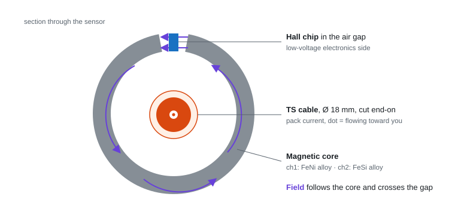

   There are two cores side by side, one per channel. Channel 1 (FeNi core,
   ±75 A) gives fine resolution near zero. Channel 2 (FeSi core, ±500 A)
   covers full power.

3. **The Hall chip turns field into voltage.** A small constant current flows
   through a thin semiconductor plate. The field pushes the charges to one
   edge, creating a voltage across the plate proportional to the field, so
   to the cable current.

   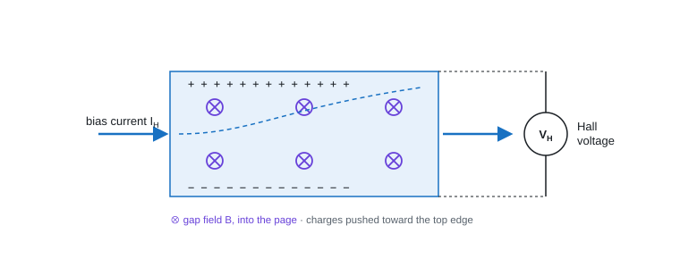

4. **The ASIC amplifies and trims it** to a ratiometric output: 2.5 V at 0 A,
   moving up or down with current, always clamped between 0.25 V and 4.75 V
   while the sensor works.

```
Uout = (UC / 5) · (S · IP + 2.5)      ⇒      IP = (5 · Uout / UC − 2.5) / S
```

| Channel | Range | Sensitivity S | Output at full range | Used for |
|---|---|---|---|---|
| 1 (FeNi) | ±75 A | 26.7 mV/A | 0.50 / 4.50 V | Low current, charging, SoC |
| 2 (FeSi) | ±500 A | 4 mV/A | 0.50 / 4.50 V | Full power, overcurrent trip |

Supply 5 V ±5% (20 mA max), bandwidth 70 Hz, load ≥ 10 kΩ and ≤ 100 nF,
connector TE 1-1456426-5 (A = 5 V, B = high range, C = GND, D = low range).

### Interface to the Master

Each output goes through a 12 kΩ / 18 kΩ divider (×0.6) to an STM32 ADC pin.
The sensor's 5 V supply is measured on a third channel with the same divider,
because the output is ratiometric.

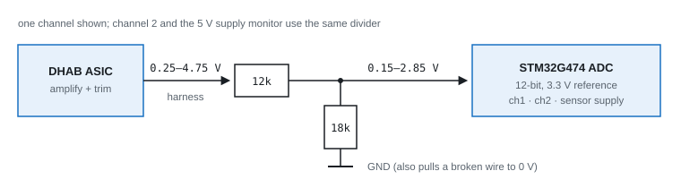

- 4.75 V max → 2.85 V at the pin; a short to 5 V → 3.0 V, so the two are distinguishable.
- The 18 kΩ bottom resistor pulls a broken wire to 0 V, which the range check catches.
- 30 kΩ total load, above the 10 kΩ minimum.
- Resolution: ~0.05 A/LSB on channel 1, ~0.34 A/LSB on channel 2, finer than the sensor error.

### Fault detection (T 11.9)

At startup the AIRs are open, so the true current is 0 A. The firmware checks
the supply, checks both channels are in range, checks both read ~0 A, and
stores the offset. Only then does the AMS report OK.

Every sample (~1 kHz) while running:

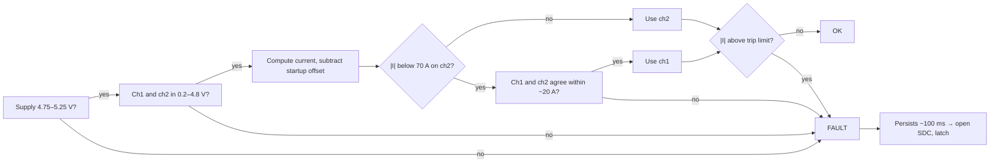

The channel is chosen from channel 2's reading because above ~84 A channel 1
sits at its 4.75 V clamp, which still looks valid.

| Failure | What the ADC sees | Caught by |
|---|---|---|
| Signal wire broken | 0 V (pull-down) | Range check |
| Signal short to GND | 0 V | Range check |
| Signal short to 5 V | 5.0 V | Range check |
| Sensor supply lost | 0 V, supply monitor low | Supply + range check |
| Sensor GND broken | Probably high | Range check, **to be confirmed on the bench** |
| Stuck at a valid value | In range | Startup zero check, ch1/ch2 plausibility |
| Connector unplugged | 0 V on both | Range check (this is the inspection test) |

### Accuracy

Worst-case total error from the datasheet:

| | −40 °C | 25 °C | 125 °C |
|---|---|---|---|
| Ch1 at 0 A | ±0.35 A | ±0.15 A | ±0.35 A |
| Ch1 at ±75 A | ±2.50 A | ±1.30 A | ±2.50 A |
| Ch2 at 0 A | ±1.80 A | ±1.00 A | ±1.80 A |
| Ch2 at ±500 A | ±15.0 A | ±9.0 A | ±15.0 A |

The overcurrent trip is set to the cell limit minus channel 2's error
(e.g. 450 A cell limit → 435 A trip), so a sensor reading low can never hide
a real overcurrent (EV 5.8.10).

### Isolation (EV 1.2.1)

The copper is at TS voltage; the Hall chip and its wires are LV. Under a
single insulation fault the cable can sit the full 403 V from LV ground. There
are two barriers in series between them:

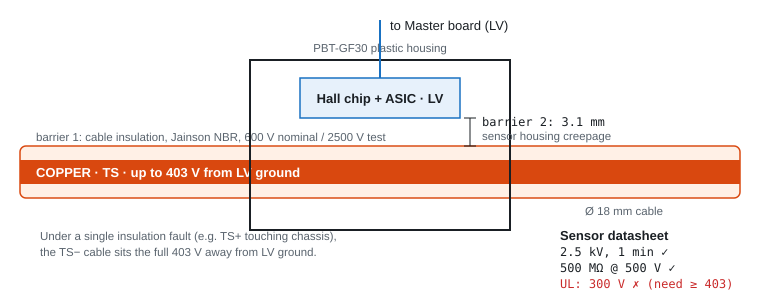

| EV 1.2.1 (max TS 403 V) | Sensor housing alone | Orange cable insulation |
|---|---|---|
| Insulation resistance ≥ 500 Ω/V (≥ 0.2 MΩ) | 500 MΩ at 500 V ✅ | Not in datasheet, measure with a megger |
| Test voltage > 3 × 403 = 1209 V, 1 min | 2.5 kV ✅ | 2500 V ✅ |
| Working voltage, if stated, > 403 V | **UL 300 V ❌** | 600 V nominal ✅ |

The sensor housing on its own fails on paper: its UL 508 rating is 300 V, and
scrutineers check this line per component (FSCZ 2025 EV inspection sheet,
items 34–35). With a bare busbar this would rule the DHAB out. With an
insulated cable, the argument is that **the 600 V-rated cable insulation is
the isolation barrier and the sensor never touches TS potential**; the housing
is a second layer. This is our interpretation, so it needs FSUK's written
confirmation.

The cable is Jainson NBR rubber welding cable, orange (`Reference Docs/TS
Cable/`): 600 V nominal, 2500 V test, −30 to +90 °C, which also meets EV 4.5.2
(insulation rated for max TS voltage) and EV 4.5.3 (≥ 85 °C). The datasheet
doesn't say whether 600 V is AC or DC.

### Mounting

The sensor hole is Ø 22.5 mm with one flat side 21.55 mm across; the cable
measures 18 mm. Fill the ~2 mm gap with a sleeve or split grommet so the cable
stays centred, and clamp the cable on both sides (EV 4.3.5; an open-loop
sensor's reading shifts slightly if the conductor moves in the hole).

### Alternatives considered

| | DHAB S/124 | LEM CAB 500-C/SP5 | LEM CAB-SF 500-C/SP1 | Isabellenhütte IVT-S | Amphenol HCSO-1WD 75/500 |
|---|---|---|---|---|---|
| Voltage rating | UL 300 V | UL 600 V | Not stated | 1000 V basic (IEC 60664) | Not stated |
| Insulation test | 2.5 kV | 2.5 kV | 2.5 kV | — | Not stated |
| Creepage | 3.1 mm | 7.2 mm | 7.2 mm | — | 3.95 mm |
| Output | Analog, 2 ch | CAN | CAN + CRC + counter, ASIL B | CAN | Analog, 2 ch |
| Supply | 5 V | 12 V | 12 V | 12/24 V | 5 V |

The CAN sensors avoid the 300 V question entirely but change the Master
design (third CAN bus instead of ADC inputs, CAN timeout/CRC checks instead of
range checks). They are the fallback if FSUK rejects the cable-insulation
argument. The HCSO-1W is electrically almost identical to the DHAB but its
datasheet gives no insulation figures at all.

### Open items

1. Read the cable type from its jacket printing: 18 mm matches both the
   double-insulated NBR/NBR 70 mm² (18.7 mm) and the single NBR 95 mm²
   (18.2 mm). Needed for EV 4.5.5 anyway.
2. Ask FSUK (rules Q&A) to confirm the cable insulation as the barrier for
   the DHAB S/124, naming the cable as welding cable.
3. Megger the cable-through-sensor assembly at 500/1000 V DC, and hipot it
   above 1209 Vrms (or ~1710 V DC) for 60 s, copper to all four sensor pins.
   Results and photos go in the ESF.
4. Bench calibration with N turns of wire through the hole (N × I looks like
   N × the current), both channels, both directions.
5. Fault-injection test for every row of the fault table, recording that the
   AMS opens the SDC in under 500 ms (T 11.9.7).

### Sources

- `Reference Docs/Current Sensor/` — DHAB S/124 (v5), CAB-SF 500-C/SP1, HCSO-1W datasheets
- `Reference Docs/TS Cable/Jainson NBR Welding Cable Datasheet.pdf`
- `Reference Docs/FSUK Rules/` — FSG 2026 v1.1 (EV 1.2.1, EV 2.2, EV 4.3.5, EV 4.5, EV 5.8, T 11.6, T 11.9) and FSUK 2026 supplementary
- [LEM CAB 500-C/SPx datasheet v4](https://www.lem.com/sites/default/files/products_datasheets/cab_500-c_spx_public_datasheet_v4.pdf), [Isabellenhütte IVT-S datasheet](https://www.isabellenhuette.com/hubfs/Files/Data-sheets/IVT-S.pdf?hsLang=en)
- [FS Czech 2025 EV inspection sheet](https://fsczech.cz/wp-content/uploads/2025/07/FSCZ25_InspectionSheet_EV.pdf) — isolation barrier checks
- [FSN 2022 accumulator inspection checklist](https://www.formula-student.nl/wp-content/uploads/2022/07/FSN-2022-Scrutineering-System-Accu-Inspection-Master.pdf) — current sensor disconnect test

## Charger interface

The BMS stops the Manzanita Micro PFC charger through the Reg Bus BLACK line
(`Charger.SchDoc`): +5 V on BLACK = charger stops, near 0 V = charger runs.

- **Fail-safe:** `CHG_EN` high = charger runs. `CHG_EN` low, MCU reset or BMS off = BLACK pulled to 5 V by the 10k = charger stops.
- **HV:** the charger is not isolated, so `+5V_REGBUS`, `GND_REGBUS` and `REGBUS_STOP` sit at mains + pack potential. Never tie `GND_REGBUS` to `GND`.
- **330R:** about 6 mA LED. The output needs 0.5 mA (5 V / 10k), PC817 CTR ≥ 50 %, so about 5× margin.
- **RJ12:** 1 `+5V_REGBUS`, 2 `REGBUS_STOP`, 4 `GND_REGBUS`. 3, 5, 6 unused.
- **Part:** we don't have an RJ12 (6P6C) jack locally, it has to be ordered online.
- **Opto isolation (EV 1.2.1, max TS 403 V):** the PC817B is the TS/LV barrier. Test voltage 5000 Vrms > 1209 Vrms ✅, working voltage V_IORM 630 V peak > 403 V ✅, insulation 5×10¹⁰ Ω > 0.2 MΩ ✅. While charging the Reg Bus side also swings to the mains peak (230 V + 10 % ≈ 360 V peak), still < 630 V. A reinforced opto is not required.
- **PCB (EV 4.3.6, 300–600 V):** 3.0 mm clearance and 20 mm creepage, or 4.0 mm with conformal coating. No opto package gives 20 mm, so coat it or slot under it, like the transformer. Check the gap across the SMD-4 (LS10.3) footprint is ≥ 4 mm.

This is the soft stop. The hard stop is the AMS opening the charging shutdown circuit (EV 7.2).

Sources: `Reference Docs/Manzanita PFC-20 Charger/` (Owners Manual, Reg Bus Wiring), `Reference Docs/Optocouplers/PC817 Datasheet.pdf`

## AMS_OK signal to the SDC

The SDC board (another team member) holds the AMS latch, reset and relays.
The BMS only sends one signal, `AMS_OK`, into a logic/comparator input on
that board: **12 V = OK, 0 V = open the SDC**.
`AMS_OK` is also used with the charger: the same signal opens the charging SDC (EV 7.2), so the AMS stops charging the same way it stops driving. It works alongside the Reg Bus soft stop on `Charger.SchDoc` (`CHG_EN`).


Q1 = AO3400A (level shift), Q2 = AO3401A (12 V high-side switch), 2K2 = output short-circuit limit.

| Case | Result |
|---|---|
| MCU says OK | Q1 on, Q2 on, `AMS_OK` = 12 V |
| MCU says fault, MCU reset, BMS unpowered | 100k holds Q1 off, Q2 off, 0 V = SDC opens |
| Wire broken | SDC board pull-down reads 0 V = SDC opens |
| Short to GND | 0 V = SDC opens, 2K2 limits the current to 5.5 mA |

**Why two MOSFETs:** a MOSFET switches on gate minus source (V_GS).
- One P-MOSFET: its source is at 12 V, so a 3.3 V pin can never pull the gate high enough to turn it off.
- One N-MOSFET on top: its gate would need to be above 12 V + threshold, which needs a charge pump.
- One N-MOSFET to GND: a short to GND would read as OK, which T 11.9 forbids.

Q1 is just a level shifter for Q2. The two 10k split the gate drive to about −6 V, inside the AO3401A's ±12 V limit.

### Parts

| | Part | LCSC | Key specs |
|---|---|---|---|
| Q1 | AO3400A (N, AOS) | C20917 | V_GS(th) 0.65 / 1.05 / 1.45 V, C_iss 630 pF, C_rss 50 pF, I_GSS ±100 nA, V_GS ±12 V |
| Q2 | AO3401A (P, AOS) | C15127 (alt. UMW C347476) | V_GS(th) −0.5 to −1.3 V, V_GS ±12 V, V_DS −30 V |

C15127 is marked "not recommended for new designs" on LCSC; the UMW AO3401A is the second source.

The AO3400A replaced the 2N7002: the 2N7002's 2.5 V max threshold left only ~0.37 V of margin at a 3.3 V pin.

### Resistor values

Inputs: STM32G474 V_OH ≥ V_DD − 0.4 = **2.9 V** up to **8 mA** (DS12288 Table 55), floating pin leakage **±150 nA** (Table 54). Q1 sinks the Q2 divider: 12 V / 20k = **0.6 mA**, so Q1 needs V_G ≥ V_GS(th)max + 0.2 V = **1.65 V**.

**Gate resistor R_G (Q1 gate):**
- Min, protect the pin: the gate looks like a short at each edge (and permanently if Q1 fails gate-source short). R_G ≥ 3.3 V / 8 mA = **412 Ω**.
- Max, Q1 must still turn on through the R_G / R_PD divider: 2.9 × 100k / (100k + R_G) ≥ 1.65 V → R_G ≤ **75 kΩ**.
- Speed is not a limit: 1k × 630 pF = 0.63 µs against the 500 ms rule.
- **1k chosen:** peak 2.9 mA (< 8 mA), V_G = 2.9 × 100/101 = **2.87 V**, 1.4 V above the worst-case threshold.

**Pull-down R_PD (Q1 gate to GND)**, holds Q1 off while the pin floats (MCU reset, before init, MCU unpowered):
- Max, leakage must not lift the gate: (150 nA pin + 100 nA gate) × 100k = **25 mV**, far below V_GS(th)min 0.65 V.
- Min, must not steal the gate drive: R_PD ≥ 1k × 1.65 / (2.9 − 1.65) = **1.3 kΩ**.
- Power-up glitch through C_rss as the 12 V rail ramps: 100k × 50 pF × 12 V/1 ms = **60 mV**.
- **100k chosen:** wastes only 3.3 V / 101k = 33 µA when on.

**Output resistor 2K2 (0805, UNI-ROYAL 0805W8F2201T5E, LCSC C17520).**
`AMS_OK` leaves the board on a cable. If that wire touches GND or the chassis,
nothing else limits the current through Q2. A resistor limits it at once (a
PTC would let amps through until it trips).
- Max, the SDC input must still see "high": with their worst-case 10k
  pull-down and LV sagging to 11 V, 11 × 10k / (10k + R) ≥ 8 V → R ≤ **3.7k**.
- Min, the resistor must survive a short: it takes the full LV voltage,
  P = V² / R. Keep it near half of the 0805's 125 mW: 12² / R ≤ 62.5 mW →
  R ≥ **2.3k** (1.15k at the full rating).
- **2K2 chosen:** short = 5.5 mA / 65 mW (94 mW at 14.4 V while charging).
  Normal = 9.8 V at a 10k pull-down, 11.7 V at 100k. 0603 (0.1 W) is too
  small for 94 mW.

### Interface to the SDC board

Values agreed with the SDC team (their input takes anything from 3 to 12 V):

| Item | Value |
|---|---|
| Signal | `AMS_OK`, one wire, for the driving SDC and the charging SDC |
| OK | High, LV supply level (12 V nominal, ≥ 9.8 V at their input) |
| Fault | Low, 0 V |
| Their input | Pull-down to GND, 10k–100k, so a broken wire or a dead BMS reads 0 V = fault |
| Their threshold | ~6 V |
| Their input must tolerate | Up to 16 V (LV battery while charging). It feeds 5 V logic, so a divider or comparator in front |
| Their latch | Trips on `AMS_OK` going low |

All four failures give a fault on their side: BMS says fault, BMS dead or
reset, broken wire, short to GND. Their first design used "high = fault" with
a pull-up; that can't detect a short to GND (T 11.9), which is why the
polarity is high = OK.

**v2:** SDC readback input, heartbeat `AMS_OK`, external watchdog.

Sources (`Reference Docs/AMS_OK Driver/`):
- onsemi AND9093, Using MOSFETs in Load Switch Applications: Fig. 3 is this circuit (P-channel switch, small NMOS level shift)
- TI SLVAES1A: a high-side N-channel MOSFET needs a bootstrap or charge pump
- AO3401A datasheet: V_GS max ±12 V, V_GS(th) −0.5 to −1.3 V
- AO3400A datasheet: V_GS(th) 0.65–1.45 V, C_iss 630 pF, C_rss 50 pF, I_GSS ±100 nA
- 2N7002 datasheets (Diodes Inc, Hongjiacheng): V_GS(th) up to 2.5 V, why it was replaced
- STM32G474 datasheet DS12288, Tables 54–55 (`Reference Docs/STM32 MCU/`)
- UNI-ROYAL 0805W8F2201T5E 2.2 kΩ 125 mW: [LCSC C17520](https://www.lcsc.com/product-detail/C17520.html)
- FSG Rules 2026 v1.1, T 11.9 (`Reference Docs/FSUK Rules/`)

## Balancing switch

A slide switch on the board that can force balancing off. It is a
**force-off override only**: switching it on never starts balancing by itself.
Balancing runs only when all of these are true:

- switch on (`BAL_EN_N` low)
- no fault, temperatures OK
- max cell > 3.9 V and spread > 20 mV
- not driving

Balancing works with the charger unplugged and stops when the spread closes.

### Circuit (`MCU_STM32.SchDoc`)

| Part | Connection | Why |
|---|---|---|
| ALPS SSSS811101 (LCSC C109335) | pin 2 (common) and tabs 4–7 to GND, pin 3 to `BAL_EN_N`, pin 1 unused | SMD right-angle slide switch, SPDT. Only reachable with the box open, so it can't be knocked by accident. |
| 10k pull-up | +3V3 to `BAL_EN_N` | Holds the line high (balancing off) when the switch is off, during MCU reset (no internal pull-up yet) and if a joint fails. |
| 100 nF | `BAL_EN_N` to GND | With the 10k, ~1 ms filter against contact bounce and noise. |

- **Active low:** switch on connects `BAL_EN_N` to GND = balancing allowed.
  Anything that goes wrong reads high = balancing off, the safe direction.
- **10k vs the switch's minimum load:** the switch needs at least 50 µA at
  3 V to switch reliably. 3.3 V / 10k = 330 µA. Keep the pull-up below ~66k.
- **Ratings:** 0.3 A / 5 V DC max, 50 µA / 3 V DC min, −40 to +85 °C.
- **PCB:** the land pattern has two ø0.9 mm locating holes; make sure the
  footprint has them.
- **Firmware:** read `BAL_EN_N` a few times before acting (debounce).

Source: `Reference Docs/Balancing Switch/ALPS SSSS811101 Datasheet.pdf`

## Power budget

Every part on every sheet, read from the schematics (all 9 sheets) and the
datasheets. **Worst case** = every load at its datasheet maximum at the same
time, every pull-up being pulled low. **Typical** = normal running (CAN about
half dominant, no faults).

### Power tree

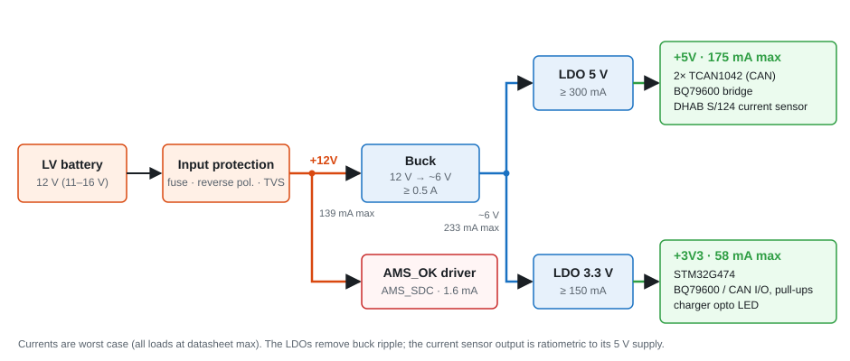

The buck does the big drop efficiently; the two LDOs remove its ripple. That
matters most for the current sensor, whose output is ratiometric to its 5 V
supply. The buck output is **6.5 V** (6.52 V), not 5.3 V: the 5 V LDO
(TLV761) has its specs written for 1.5 V of headroom (VIN = VOUT + 1.5 V), see
[LDOs](#ldos-5v-3v3).

Power-port names on every sheet: **`+12V`, `+5V`, `+3V3`** (`+5V_REGBUS` is the
charger's isolated 5 V and stays separate). `Power.SchDoc` must use these
exact names.

### +3V3 (LDO from the buck)

| Load | Sheet | Worst | Typical | Source |
|---|---|---|---|---|
| STM32G474 core, 170 MHz | MCU_STM32 | 34 mA | 30 mA | DS12288 Table 21, max at 85 °C, peripherals off |
| STM32 peripherals in use (2× FDCAN, SPI, ADC1/2, DMA, timers, GPIO) | MCU_STM32 | 11 mA | 9 mA | DS12288 Table 35 (µA/MHz × 170 MHz) |
| STM32 ADC analog | MCU_STM32 | 2 mA | 1 mA | estimate |
| CHG_EN opto LED (330R from a GPIO) | Charger | 6.5 mA | 6.5 mA | while charging is allowed |
| AMS_OK_MCU (1k + 100k) | AMS_SDC | 0.03 mA | 0.03 mA | 3.3 V / 101k |
| BQ79600 VIO | Stack_Interface | 0.5 mA | 0.2 mA | estimate, not in the datasheet |
| 2× TCAN1042 VIO | CAN | 0.6 mA | 0.2 mA | 300 µA max each |
| BQ79600 pull-ups: nCS, MOSI, MISO 10k, SCLK 10k pull-down, NFAULT and SPI_RDY 100k | Stack_Interface | 1.4 mA | 0.5 mA | 0.33 mA per 10k only while its line is low (SCLK: high) |
| CAN TXD/RXD pull-ups, 4× 10k | CAN | 1.3 mA | 0.7 mA | only while the line is low (dominant) |
| BAL_EN_N pull-up 10k | MCU_STM32 | 0.33 mA | 0 mA | only while the switch is on |
| NRST pull-up 10k, BOOT0 pull-down 10k | MCU_STM32 | 0.33 mA | 0 mA | NRST only during reset; BOOT0 sits low |
| **Total** | | **≈ 58 mA** | **≈ 48 mA** | |

LDO dissipation: (6.52 − 3.3) V × 58 mA ≈ **0.19 W**. Rate it **≥ 150 mA**.

### +5V (LDO from the buck)

| Load | Sheet | Worst | Typical | Source |
|---|---|---|---|---|
| 2× TCAN1042 VCC | CAN | 140 mA | 42 mA | 70 mA max each dominant at 60 Ω, 1.5 mA recessive; typical = half dominant (40 mA typ) |
| BQ79600 BAT/CVDD/INH | Stack_Interface | 14 mA | 4 mA | 4 mA ACTIVE + 10 mA while transmitting (BQ79600 datasheet) |
| LEM DHAB S/124 | Current_Sense | 20 mA | 15 mA | DHAB datasheet, both channels |
| Current-sense dividers (3× 12k + 18k) | Current_Sense | 0.5 mA | 0.4 mA | 5 V / 30k + 2 × 4.75 V / 30k |
| **Total** | | **≈ 175 mA** | **≈ 61 mA** | |

LDO dissipation: (6.52 − 5) V × 175 mA ≈ **0.27 W**. Rate it **≥ 300 mA**, with
dropout ≤ 0.5 V at 175 mA. A CAN bus fault can push one transceiver to
110 mA; the TCAN1042's dominant time-out stops a stuck TXD from holding it
there.

### Buck (6.5 V out)

| | Worst | Typical |
|---|---|---|
| Output current: +5V LDO + +3V3 LDO | 233 mA | 109 mA |
| Output power: 6.52 V × current | 1.52 W | 0.71 W |
| Input power at 85 % efficiency | 1.79 W | 0.84 W |

Rate the buck **≥ 0.5 A** output (2× margin), input range covering the LV
battery (12 V nominal, up to ~16 V while charging).

### +12V (LV input)

| Load | Sheet | Worst | Typical |
|---|---|---|---|
| Buck input: 1.79 W / 12 V (0.84 W typical) | Power | 149 mA | 70 mA |
| AMS_OK driver: Q2 gate divider 12 V / 20k | AMS_SDC | 0.6 mA | 0.6 mA |
| AMS_OK output into the SDC pull-down (2K2 + 10k worst) | AMS_SDC | 1.0 mA | 0.1 mA |
| **Total from the LV supply** | | **≈ 151 mA, 1.8 W** | **≈ 71 mA, 0.85 W** |

At 11 V (low LV battery) the worst case rises to ≈ 165 mA.

**Not on our budget:** the 10k Reg Bus pull-up on `Charger.SchDoc` (0.5 mA)
is powered by the charger's own `+5V_REGBUS`, not by this board.

**To confirm once the parts are picked:** buck efficiency at 6.5 V / 0.2 A,
LDO dropout and quiescent current, BQ79600 VIO current.

Sources: TCAN1042-Q1 datasheet (Supply Characteristics), BQ79600-Q1
datasheet (Supply currents), STM32G474 DS12288 Tables 21 and 35, LEM DHAB
S/124 datasheet v5 (Electrical data).

## LV input protection

Between the LV connector (`LV_IN`) and the protected `+12V` rail, on
`Power.SchDoc`. Everything after it (buck, bulk cap, AMS_OK driver on
`AMS_SDC.SchDoc`) is on `+12V`, so it's all behind the protection.


### Parts

| Ref | Part | LCSC | Job | Key ratings |
|---|---|---|---|---|
| F1 | Littelfuse 0452001.MRL (Nano2 452, slow-blow) | C44669 | Opens on a short downstream | 1 A, 125 V DC, 50 A interrupt, 2410 SMD |
| D1 | SS34 Schottky (MDD) | C8678 | Reverse polarity: blocks if LV is connected backwards | 40 V, 3 A, 80 A surge, SMA |
| D2 | Littelfuse SMBJ16A TVS | C151254 | Clamps positive spikes (load dump, inductive kicks) | 16 V standoff, 17.8 V breakdown min, 26 V clamp at 23 A, 600 W, SMB |

### Why this order

`LV_IN → F1 → D1 → +12V`, with D2 from `+12V` to GND.

- **TVS after the diode, not before it.** A reversed battery would
  forward-bias a TVS placed before D1, short the input and blow the fuse.
  After D1, it's protected by the diode.
- **Fuse first:** it protects everything, including D1 and D2, from a short.
- **D2's cathode (band) is on `+12V`.** It's unidirectional, so orientation
  matters.

### Sizing

- **Fuse: slow-blow ~1 A.**
  - Worst-case load is 151 mA (see [+12V](#12v-lv-input)), so 1 A gives
    plenty of margin.
  - The hot-plug simulation shows 58.7 A of inrush for about 8 µs, which is
    roughly 58.7² × 8 µs / 3 ≈ 0.01 A²s.
  - A small fast fuse could nuisance-blow on that. A 1 A slow-blow needs far
    more to melt (LCSC lists 4.06 A²s melting I²t for the equivalent
    JDTfuse JFC2410-1100TS), so it only opens on a real fault.
  - DC rating (125 V) is well above our 16 V.
- **D1 SS34 instead of a P-MOSFET.**
  - At 151 mA it drops about 0.3–0.4 V and dissipates about 0.06 W.
  - Its 80 A surge rating covers the 58.7 A inrush.
  - A P-MOSFET would save the drop, but needs a gate zener and resistor;
    it's only worth it above an amp or two.
  - The drop moves the buck's turn-on from 8.0 V at `+12V` to about 8.4 V at
    the connector.
- **D2 SMBJ16A.**
  - 16 V standoff, so it doesn't conduct at 16 V while charging.
  - It clamps at 26 V, under the TPS62933F's 32 V absolute max.

### Simulation (hot-plug)

16 V switched onto about 1 m of harness (1 µH, 50 mΩ) in 1 µs. Files:
`sim/buck/buck_hotplug_tvs.cir`, `buck_hotplug_notvs.cir`,
`buck_hotplug_nobulk.cir`.

| Case | VIN peak | TVS current | Inrush peak |
|---|---|---|---|
| Our design (100 µF bulk + TVS) | **17.07 V** | 0 A (never reaches its 17.8 V breakdown) | 58.7 A |
| No TVS | 17.07 V | — | 58.7 A |
| **No bulk cap**, TVS fitted | **24.2 V** (clamped) | **17.0 A** | 48.3 A |

- **The 100 µF bulk cap does the real work:** its 0.3 Ω ESR damps the
  harness LC ringing, so VIN only overshoots by 1 V.
- **The TVS is the backstop** if the cap is missing or fails. It held VIN at
  24 V, under the buck's 32 V absolute max, and 17 A for a few µs is well
  within its 600 W rating.
- The TVS model is approximate, built from the datasheet's breakdown and
  clamp figures, not a vendor model.

### Power while charging

While the car is on the charger, the board is powered from **a separate
battery, just like the LV battery** (12 V nominal). It's the same voltage
range, so it goes into the same `LV_IN` input and through the same
protection. No change to the input stage.

### Still open

- `LV_IN` gets its other end when the LV connector is drawn on
  `Connectors.SchDoc` and wired through `Top.SchDoc`.

Sources: Littelfuse 0452 series and SMBJ series ratings from LCSC listings
(C44669, C151254); SS34 ratings from LCSC C8678; SMBJ datasheet in
`Reference Docs/Power/`. Simulation results from the files above.

## Buck converter: TPS62933F

12 V LV battery → **6.5 V**, feeding the `+5V` and `+3V3` LDOs (see
[Power tree](#power-tree)). Rated 1 A for a 233 mA worst-case load.

### Part

**TI TPS62933F** (`TPS62933FDRLR`, SOT-583, LCSC C5219272).

- 3.8–30 V input, 3 A synchronous buck.
- **FCCM:** forced continuous mode, which keeps switching at a fixed
  frequency even at light load. That keeps the ripple predictable for the LDOs.
- 500 kHz with the RT pin left open.
- 0.8 V reference.
- Not AEC-Q100. That's acceptable for v1.

Datasheet: `Reference Docs/Power/` (SLUSEA4D).

### Why this buck

**Why a buck at all, and not just two LDOs from 12 V.** At the worst-case
load, two LDOs from 12 V would burn the whole voltage drop as heat:

| Supply | Calculation | Heat |
|---|---|---|
| `+5V` | (12 − 5) V × 175 mA | 1.2 W |
| `+3V3` | (12 − 3.3) V × 58 mA | 0.5 W |
| **Total at 12 V** | | **1.7 W** |
| **Total at 16 V** (charging) | | **2.7 W** |

That needs big packages and copper. With the buck to 6.5 V first, the LDOs
only drop 1.5–3.2 V, which is 0.46 W together, and the buck itself loses about
0.27 W at 85 % efficiency.

**The options.** The main alternative was the **TI LMR51430**, which is what
the LSU BMS motherboard uses (see `FSAE_LSU_BMS/MotherBoard`). We also
considered the other members of our part's family.

| | **TPS62933F** (chosen) | LMR51430XF (FPWM, 500 kHz) | TPS62932 / TPS62933 |
|---|---|---|---|
| Input range (abs max) | 3.8–30 V (32 V) | **4.5–36 V (38 V)** | 3.8–30 V (32 V) |
| Output current | 3 A | 3 A | 2 A / 3 A |
| Light-load mode | **FCCM, fixed frequency** | **FPWM, fixed frequency** | PFM: frequency drops at light load |
| Switching frequency | **200 kHz–2.2 MHz, set by RT** | 500 kHz fixed | 200 kHz–2.2 MHz |
| Soft start | **Set by C_SS** (33 nF ≈ 5 ms) | Fixed internal, 3.2–5.4 ms | Set by C_SS |
| MOSFETs (high / low side) | **76 / 32 mΩ** | 120 / 70 mΩ | 76 / 32 mΩ |
| FB reference | 0.8 V ±1.5 % (0–85 °C) | 0.6 V ±1.5 % | 0.8 V ±1.5 % |
| Package | SOT-583, 1.6 × 2.1 mm, 0.5 mm pitch | **SOT-23-6, easier to hand solder** | SOT-583 |
| Simulation model | TI PSpice model, run in LTspice ([Simulation](#simulation-ltspice)) | not checked | not checked |

**Why the TPS62933F.**

- **Fixed frequency at our load.** Our load is only 0.1–0.23 A. At that load
  the PFM parts (TPS62932/33) switch in bursts, at a frequency that moves with
  the load. FCCM keeps switching at a steady 500 kHz, which TI says "maintains
  lower output ripple during all load conditions", and the ripple stays at one
  known frequency.
  - The LMR51430's FPWM version does this too, so this rules out the PFM
    parts, not the LMR.
- **Adjustable soft start and frequency.** C_SS sets the start-up ramp, and RT
  can move the frequency later (for example away from a noise problem
  measured on the bench) without changing the part. The LMR51430 has neither.
- **Lower switch resistance.** 76 / 32 mΩ against 120 / 70 mΩ. At 0.23 A this
  is a small saving; it matters more if the 6.5 V rail ever carries more load.
- **We have a working design and a verified simulation.** WEBENCH generated the
  design, and the TI model runs in LTspice with results that match the
  datasheet.
- **Stock:** LCSC C5219272, 1131 pcs on 2026-10-21.

**What we gave up.**

- **Input headroom:** 30 V maximum operating (32 V absolute) against the
  LMR51430's 36 V (38 V). The SMBJ16A TVS clamps at 26 V, under 32 V, so the
  input stage must keep that TVS. The LMR51430 would have had about 12 V more
  margin.
- **Package:** SOT-583 has a 0.5 mm pitch, which needs care when hand
  soldering; SOT-23-6 is easier.
- **Not automotive:** not AEC-Q100. The LMR51430 isn't either.

Sources: TPS6293x datasheet SLUSEA4D (Features, Electrical Characteristics),
LMR51430 datasheet SLUSEF4A (Features, Device Comparison, Absolute Maximum
Ratings, Electrical Characteristics), both in `Reference Docs/Power/`.
Load currents from [Power budget](#power-budget).

### Design


`Power.SchDoc`. RT is left open (500 kHz). The LTspice copy of this circuit is
in [Simulation](#simulation-ltspice).

Made in TI WEBENCH for 9–16 V in → 6 V at 1 A, then raised to 6.5 V by changing R_FBT (see the BOM table). The design files are in
`Reference Docs/Power/WEBENCH TPS62933F (9-16V to 6V 1A)/`. We kept the
WEBENCH values except where a part wasn't on LCSC or a better one was. The
final list is `LCSC BOM.csv` in that folder.

> **Note: the inductor and output capacitor values come from WEBENCH, not
> from my own analysis.** The design works (the simulations below pass), but
> I don't fully understand yet why those values were chosen. Following
> feedback, I need to read **chapters 2 and 3** of *Fundamentals of Power
> Electronics* (Robert W. Erickson and Dragan Maksimović, 2nd edition):
> steady-state converter analysis (inductor volt-second and capacitor
> charge balance, ripple), and steady-state equivalent circuits, losses and
> efficiency. Then check the L and C_out values against that analysis.

| Ref | Value | Part (LCSC) | Why |
|---|---|---|---|
| U1 | TPS62933F | TPS62933FDRLR (C5219272) | |
| C_bulk | 100 µF 35 V electrolytic | EEEFT1V101AP (C128464) | damps the ringing of the harness inductance with the ceramics at power-on (added) |
| C_in1, C_in2 | 10 µF 50 V X5R 1206 | CL31A106KBHNNNE (C13585) | input ripple current; 50 V because ceramics lose capacitance with DC voltage |
| C_inx | 100 nF 50 V 0402 | CL05B104KB54PNC (C307331) | high-frequency decoupling right at VIN |
| C_boot | 100 nF | CL05B104KO5NNNC (C1525) | bootstrap supply for the high-side gate drive |
| C_ss | 33 nF | FCC0402B333K500AT (C7419416) | soft start, ~4–5 ms ramp |
| L1 | 8.2 µH, 83 mΩ max, Isat 2.74 A | APV ANR5040T8R2M (C7427138) | WEBENCH's NIC part isn't on LCSC; ripple ≈ 0.8 A p-p, peak 1.46 A at 1 A load |
| C_out | 47 µF 16 V X5R 1210 | CL32A476KOJNNNE (C2932477) | output ripple |
| C_ff | 6.8 pF C0G | CL05C6R8CB5NNNC (C318598) | feed-forward across R_FBT: more phase margin, smaller dip on a load step |
| R_FBT / R_FBB | 71.5k / 10k | C43534 / C25744 | Vout = 0.8 × (1 + 71.5k/10k) = **6.52 V**. Was 64.9k (5.99 V); raised so the 5 V LDO gets the 1.5 V headroom its specs assume |
| R_ENT / R_ENB | 511k / 86.6k | C64042 / C19709 | UVLO: on at 8.0 V, off at 7.0 V |

**UVLO.** The buck only starts once the battery is above 8 V and stops below
7 V. This stops it running from a flat or sagging LV battery. WEBENCH's
1.18M / 169k gave about 8.8 V on and 6.9 V off.

**Ripple target ≤ 30 mV.** The LDO after the buck rejects about 40 dB (100×) at
500 kHz. Half an ADC LSB is about 0.4 mV, and 0.4 mV × 100 = 40 mV, so 30 mV
leaves margin.

### Simulation (LTspice)

Files are in [`sim/buck/`](sim/buck/):

| File | What |
|---|---|
| `buck_startup.asc` | the schematic, with the same values as the BOM table above |
| `TPS62933F_LTspice.lib` | TI's model, patched so it runs in LTspice |
| `TPS62933F.asy` | symbol for the model |
| `buck_startup.log` | results (`.meas` lines at the end) |
| `charts/` | plots of the run: `index.html` shows all of them, `make_charts.py` regenerates them |
| `buck_startup_schematic.svg` | the image below, drawn from `buck_startup.asc` by `asc2svg.py` (`python asc2svg.py buck_startup.asc buck_startup_schematic.svg`) |

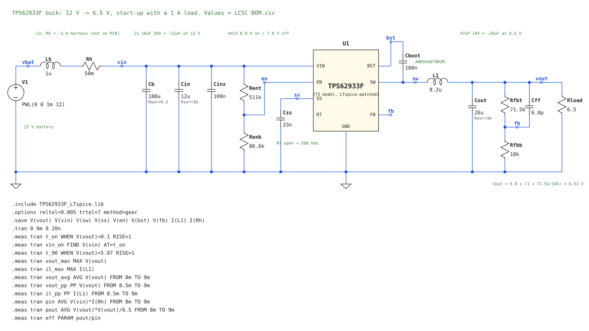

**Model.** TI's `TPS62933F_TRANS` PSpice transient model (SLUM859,
`Reference Docs/Power/TPS62933F PSpice Model (SLUM859)/`). It models soft
start, UVLO/EN, FCCM, current-mode control, the bootstrap, and over-current
and over/under-voltage protection. It does **not** model quiescent current or
temperature.

**Patches to run it in LTspice.** As shipped, the model stalls in LTspice: the
time step collapses to femtoseconds at the switching edges. Four numerical
changes fix it, and the circuit stays the same:

1. Clamp diodes inside the latches: emission coefficient N 0.01 → 1. LTspice's
   own troubleshooting guide lists near-vertical diodes as a convergence killer.
2. "Ideal" diodes: N 0.001 → 0.1.
3. 2 ps logic delays → 2 ns. One switching cycle is 2000 ns.
4. PSpice `VSWITCH` switches → LTspice `SW` switches, with the same on/off
   resistance and the same smooth on/off transition (`Vh` negative).

Solver settings: `.options reltol=0.005 trtol=7 method=gear`. A 9 ms run takes
about 6 minutes.

**What's simulated.**

- The battery ramps 0 → 12 V in 1 ms.
- A **harness model** between the battery and the board: `Lh` 1 µH + `Rh` 50 mΩ,
  about 1 m of wire. It is **not on the PCB**; it's there because the wire
  inductance can ring with the input caps at power-on.
- Ceramics at their capacitance under DC voltage (estimates):
  - C_in: 2 × 10 µF → 12 µF at 12 V.
  - C_out: 47 µF → 26 µF at 6.5 V.
- 1 A load (6.5 Ω).
- L1 at its maximum DCR.

**Results: start-up at 12 V, 1 A load** (buck at 6.52 V; the 6.0 V run is kept in `sim/buck/results/buck_startup_6V0.log`).

| Check | Target | Result |
|---|---|---|
| Turn-on voltage (UVLO) | 8.0 V | **8.07 V** |
| Rise to 90 % (5.87 V) after turn-on | smooth, ~5 ms | **3.86 ms**, no overshoot |
| Output peak | no overshoot | **6.529 V** (+0.13 %) |
| Output (steady state) | 6.52 V | **6.521 V** |
| Output ripple | ≤ 30 mV p-p | **13.3 mV p-p** |
| Inductor ripple | ~0.73 A p-p (calculated) | **0.78 A p-p** |
| Inductor peak | < 2.74 A (Isat) | **1.92 A**, during start-up (30 % margin) |
| Efficiency | | 97.7 %, which is **too high**: see below |

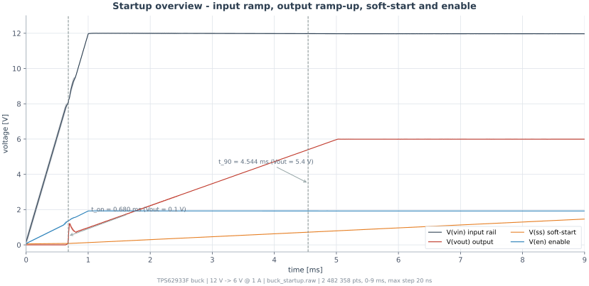

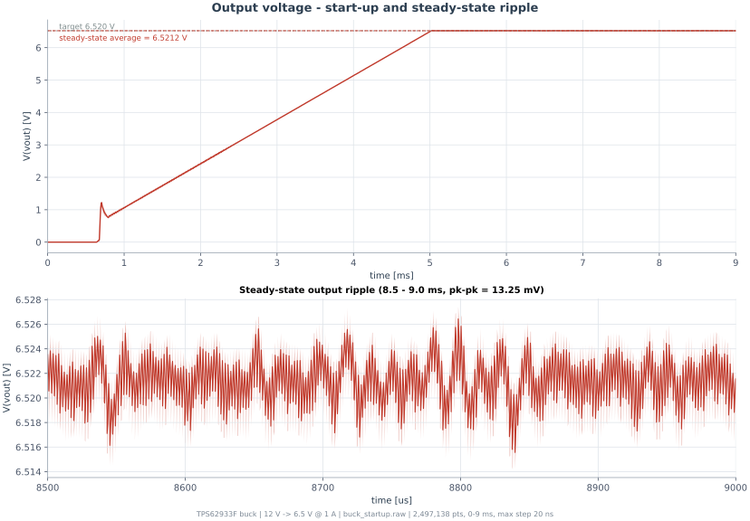

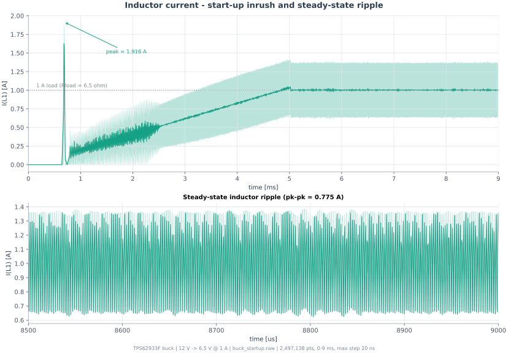

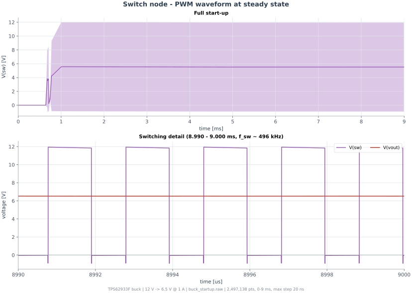

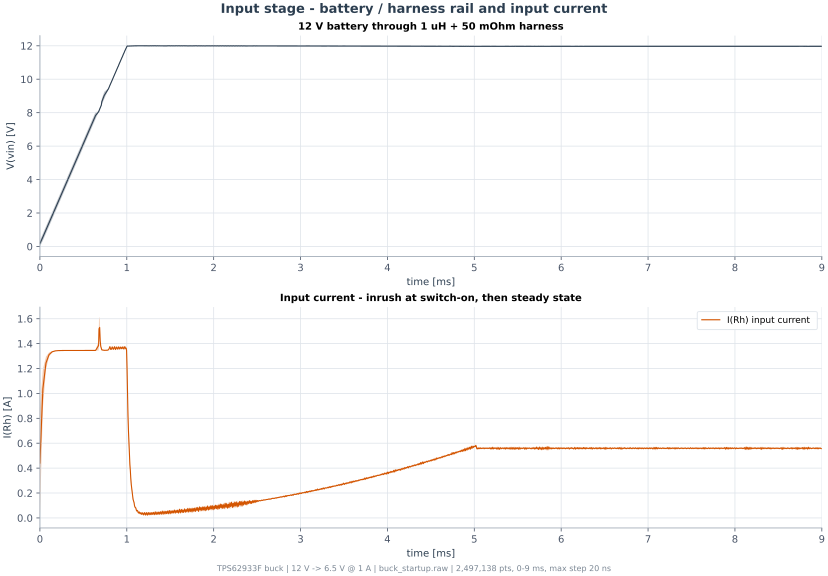

More charts (power and efficiency, control signals, a start-up close-up, and a
summary dashboard) are in [`sim/buck/charts/`](sim/buck/charts/).

**Limits of this result.**

- **Efficiency:** the model has no quiescent current and simplified switching
  losses. Use the datasheet curve (about 90 % at 1 A) for the power budget.
- **The model is patched.** The behaviour matches the datasheet (UVLO
  threshold, soft-start time, ripple), but it hasn't been checked against TI's
  original model in PSpice.
- **Estimated values:** the cap values under DC voltage and the harness values
  are estimates, not measured.
- **Load:** 1 A is four times our worst-case load (233 mA), so the real ripple
  and stress are lower.

### More simulations: load step and input range

Netlists in `sim/buck/`: `buck_loadstep.cir`, `buck_vin9.cir`,
`buck_vin11.cir`, `buck_vin16.cir`, plus the comparison runs
`buck_vin9_6V0.cir` (old 6.0 V output) and `buck_vin9_2cout.cir`
(2× 47 µF). Each log has the measurements at the end. Hot-plug results are in
[LV input protection](#lv-input-protection).

**Load step, 12 V in:** 0.1 A → 1 A at 6 ms, back to 0.1 A at 7 ms.

| Check | Result | |
|---|---|---|
| Dip when the load jumps to 1 A | 176 mV (2.7 %) | ✅ |
| Overshoot when it drops back | 144 mV (2.2 %) | ✅ |
| Settles to | 6.521 V | ✅ |

**Input range, 1 A load:**

| Input | Output C | Output | Output ripple | Inductor ripple (calc.) | |
|---|---|---|---|---|---|
| 16 V | 1× 47 µF | 6.521 V | 14.3 mV | 1.00 A (1.00 A) | ✅ |
| 11 V | 1× 47 µF | 6.521 V | 14.0 mV | 0.71 A (0.65 A) | ✅ |
| **9 V** | **1× 47 µF** | 6.520 V | **275 mV** | **2.50 A** (0.44 A) | ❌ **loop oscillates** |
| 9 V, old 6.0 V output | 1× 47 µF | 5.994 V | 311 mV | 3.02 A | ❌ same problem |
| **9 V** | **2× 47 µF** | 6.521 V | **5.4 mV** | **0.46 A** (0.44 A) | ✅ |

**At 9 V input the control loop oscillates.**
- The on-time swings between about 0.9 and 2.9 µs over roughly 10 switching
  cycles, instead of a steady 1.46 µs.
- It isn't caused by the 6.5 V change: the original 6.0 V WEBENCH design
  does the same.
- It only shows at low input, which means high duty cycle (72 %). With one
  47 µF (about 26 µF left at 6.5 V because of DC bias), the loop runs out of
  phase margin there.
- **A second 47 µF on the output fixes it.** The inductor ripple then matches
  the hand calculation (steady switching), and the output ripple halves.

**Recommendation: add a second 47 µF 16 V X5R 1210 (CL32A476KOJNNNE, C2932477)
on the buck output, in parallel with the first.** This comes from the patched
TI model, not hardware, so confirm on the bench: drop the input to 9 V and
watch SW and the output on a scope.

Also open: the UVLO lets the buck run down to 7 V input, but a 12 V LV
battery is flat long before that. Raising the UVLO to switch off around 10 V
is a two-resistor change if the bench shows trouble at low input.

## LDOs (+5V, +3V3)

Two LDOs take the buck's 6.5 V down to `+5V` and `+3V3` and clean off the buck's
ripple. **Chosen: TI TLV761.** We use the **5 V version, TI TLV76150DCYR**,
for `+5V` and the **3.3 V version, TI TLV76133DCYR**, for `+3V3`.

| Rail | Part | Output | Current rating | Our load | Package | LCSC |
|---|---|---|---|---|---|---|
| `+5V` | TLV76150DCYR | fixed 5.0 V | 1 A | 175 mA | SOT-223 | C5845194 |
| `+3V3` | TLV76133DCYR | fixed 3.3 V | 1 A | 58 mA | SOT-223 | C7527500 |


On `Power.SchDoc`: each LDO takes `+6V5` on IN (pin 3) and has its OUT pin 2 tied to
the tab (pin 4). C_IN and C_OUT are both 2.2 µF 25 V X7R 0805 (CL21B225KAFNNNE, C19110),
per the datasheet's 2.2 µF nominal C_OUT and 1 µF nominal C_IN.

### Reading the output voltage from the part number

The datasheet never prints "TLV76133 = 3.3 V" in one line. The voltage is
coded into the part number, and the code is explained in a separate table.
Page numbers below are for the TLV761 datasheet, revision D (English
SBVS349D and Chinese ZHCSKS3D, both in `Reference Docs/LDO/`):

- **Page 19, section 8.1.1, Table 8-1 "Available Options"** (device
  nomenclature). The format is `TLV761 abxxxy`: "ab is the nominal output
  voltage… use 33 for 3.3V". So `TLV761·33·DCY·R` breaks down as:

  | Field | Value | Meaning |
  |---|---|---|
  | `ab` | 33 | 3.3 V |
  | `xxx` | DCY | SOT-223 package |
  | `y` | R | reel |

  The same rule gives `50` = 5.0 V, so the 5 V part is **TLV76150DCYR**.
- **Page 21, Package Option Addendum:** `TLV76133DCYR`, SOT-223 (DCY),
  Active / Production, marking "76133C". `TLV76150DCYR` is listed on the same
  page, also active.
- **Page 16, design example:** "the 3.3-V, fixed-version TLV76133 is selected
  and is powered by a standard 12-V input". That's the datasheet naming it as
  3.3 V in words.

Page 1 only says "fixed output, 0.8 V to 13 V in 100 mV steps", because it
describes the whole family. That's why it's easy to miss.

### What we were looking for

| Requirement | Value | Why |
|---|---|---|
| Input max | **≥ 16 V** | 6.5 V in normally, but a buck with a shorted high-side switch puts 12–16 V on the LDO. It must survive and keep regulating so nothing downstream sees it. |
| Output | **fixed 5.0 V / 3.3 V** | No external divider, so no resistor tolerance added on top. |
| Accuracy | **±1–2 % over temperature** | The current sensor's output is ratiometric to 5 V. |
| Dropout | **< 0.5 V at 175 mA** (5 V rail) | The buck was 6 V when we searched (1 V of headroom); it's now 6.5 V. |
| Current | ≥ 800 mA rating | Worst-case loads are 175 mA (`+5V`) and 58 mA (`+3V3`). |
| PSRR at 500 kHz | **≥ 30 dB** | Knocks the buck's 13 mV ripple below half an ADC step (0.4 mV); see [PSRR](#psrr-how-much-buck-ripple-gets-through). |
| Package | **SOT-223 or similar leaded** | Hand soldered; no WSON/QFN. |

### Candidates

All datasheets are in `Reference Docs/LDO/`.

| Part | Input (operating) | Fixed 5 V and 3.3 V | Current | Accuracy over temp | PSRR, highest frequency given | Package | Result |
|---|---|---|---|---|---|---|---|
| **TI TLV761** | 2.5–18 V | yes | 1 A | **±1.75 %** | **40 dB @ 1 MHz** | **SOT-223** | **chosen** |
| TI TLV767 / TLV767-Q1 | 2.5–16 V | yes | 1 A | ±1 % | 46 dB @ 1 MHz | WSON / HVSSOP | ✗ package not hand-solderable |
| ST LDL1117 | 2.6–18 V | yes | 1.2 A | ±3 % | ~44 dB @ 100 kHz (curve stops there, ~30 dB @ 500 kHz extrapolated) | SOT-223 | ✗ accuracy, no margin on PSRR |
| Microchip MIC39100 | 2.25–16 V | yes | 1 A | ±2 % | curves only, not readable at 500 kHz | SOT-223 | ✗ PSRR unknown, ~4× the price |
| MaxLinear SPX3819 | 2.5–16 V | yes | 500 mA | ±2 % | "70 dB", frequency not stated | SOT-23-5 | ✗ PSRR unknown, below 800 mA |
| TI LP38692 | 2.7–10 V | yes | 1 A | ±5 % | 50 dB @ 100 kHz | SOT-223 | ✗ accuracy |
| TI LM1117 | up to 15 V | yes | 800 mA | ±1–2 % | low | SOT-223 | ✗ dropout 1.2 V |
| Diodes ZLDO1117Q | 2.7–18 V | yes | 1 A | ±2 % | low | SOT-223 | ✗ dropout up to 1.2 V |
| Diodes AP7361C | 2.2–6.0 V | 3.3 V only | 1 A | ±1 % | dips to 20–25 dB near 300–500 kHz | SOT-223 | ✗ 6 V max, no fixed 5 V |
| Diodes AP2114 | up to 6.0 V | 3.3 V only | 1 A | ±1.5 % | 68 dB @ 1 kHz | SOT-223 | ✗ 6 V max |
| CJ CJ6109 | 1.6–6.0 V | up to 5 V | 1 A | ±2 % | 70 dB @ 10 kHz | SOT-223 | ✗ 6 V max |
| Ricoh RP131x | 1.6–6.5 V | — | 1 A | ±1 % | 70 dB @ 1 kHz | SOT-89-5, DFN | ✗ 6.5 V max |
| Runic RS3215 | 2.7–6.5 V | 3.3 V only | 500 mA | ±0.75 % | 75 dB @ 100 Hz | SOT-23-5 | ✗ 6.5 V max |
| TI LP5912-EP | 1.6–6.5 V | — | 500 mA | — | 75 dB @ 1 kHz | WSON | ✗ 6.5 V max, package |
| Richtek RTQ2539A | 1.1–6.5 V | — | 3 A | ±1 % | 40 dB @ 500 kHz | WQFN | ✗ 6.5 V max, package |
| TI TPS7A88 (dual) | 1.4–6.5 V | adjustable only | 2 × 1 A | ±1 % | 40 dB @ 1 MHz | WQFN | ✗ 6.5 V max, adjustable, package |

**The input limit eliminated most of them.** Any part rated for 6.0–6.5 V
would run at or over its limit from our 6.5 V and die if the buck fails. That alone
removes AP7361C, AP2114, CJ6109, RP131x, RS3215, LP5912, RTQ2539A and TPS7A88,
even the ones with good PSRR. The old x1117 regulators (LM1117, ZLDO1117Q)
take 15–18 V but need about 1.2 V of dropout, more than the 1 V we have.

### Why the TLV761

- **18 V input:** survives a shorted buck and keeps both rails regulated.
- **Fixed 5.0 V and 3.3 V:** no external resistors.
- **±1.75 % over temperature, line and load:** the best of the SOT-223 parts.
- **Dropout:** 0.9 V typical / 1.6 V max at 1 A. It's a CMOS pass transistor,
  so dropout scales with current: about 0.16 V typical / 0.28 V max at our
  175 mA. That's well inside 1 V.
- **PSRR:** 60 dB at 1 kHz and 40 dB at 1 MHz, so roughly 43–46 dB at
  500 kHz. That's about 13 dB above the 30 dB we need. It's the only
  hand-solderable part that publishes a high-frequency PSRR figure.
- **SOT-223** with the standard x1117 pinout: 1 GND, 2 OUT (and tab), 3 IN.
- **1 A, 95.4 °C/W:** 0.27 W (5 V rail) gives about +25 °C; 0.19 W (3.3 V rail) about +18 °C.
- **Stable with a 1 µF ceramic output capacitor** (1–220 µF allowed).

**Caveats:**
- **Headroom on the 5 V rail (resolved).** The datasheet's Electrical
  Characteristics are specified at **VIN = VOUT + 1.5 V**, which is 6.5 V for
  the 5 V part. With the buck at 6.0 V it would have had only 1.0 V.
  - It would still regulate (dropout is at most 0.28 V at 175 mA).
  - But accuracy, line regulation and PSRR are only characterised at 1.5 V
    of headroom, and PSRR drops as headroom shrinks (figure 5-18).
  - **So the buck was raised to 6.52 V** (R_FBT 64.9k → 71.5k). Every spec
    now applies as written, at a cost of 0.27 W in the 5 V LDO and 0.19 W in
    the 3.3 V LDO.
- **Foldback current limit.** With the output shorted, the TLV761 limits to
  150 mA min / 250 mA typ / 350 mA max, rising back towards 1.1 A as the
  output recovers.
  - A load drawing more than about 150 mA while the rail is still low at
    power-up could hold it down.
  - Ours doesn't: the 175 mA worst case needs both CAN buses active, which
    needs the MCU running.
  - Check the 5 V rail's power-up on the bench.
- **The PSRR curves in the datasheet are at 1.8 V out from 3.3 V in.**
- **Not AEC-Q100.** None of the SOT-223 candidates are.
- **Verify on the bench:** scope `+5V` and `+3V3`, AC coupled with the 20 MHz
  limit on; the ripple must be under 0.4 mV.

Sources: TLV761 datasheet SBVS349D (Recommended Operating Conditions,
Electrical Characteristics, Thermal Information, Pin Functions); the other
datasheets in `Reference Docs/LDO/`; TPS7A88 figures from the
[TI product page](https://www.ti.com/product/TPS7A88). Stock from LCSC,
2026-10-23.

### PSRR: how much buck ripple gets through

PSRR (power supply rejection ratio) is how well the LDO stops ripple on its
input from reaching its output:

```
PSRR (dB) = 20 × log10( V_ripple,in / V_ripple,out )
V_ripple,out = V_ripple,in / 10^(PSRR / 20)
```

**Higher is better.** PSRR is the ratio of input to output ripple, so a bigger
ratio means less ripple out. Every 20 dB divides the ripple by 10 more.

| PSRR | Ripple divided by | Our 13 mV of buck ripple becomes |
|---|---|---|
| 20 dB | 10 | 1.3 mV |
| 40 dB | 100 | 130 µV |
| 48 dB | 251 | 52 µV |
| 60 dB | 1000 | 13 µV |

**What we need.** The 12-bit ADC at 3.3 V has a step of 0.8 mV, so half a
step is 0.4 mV. We need 13 mV / 0.4 mV ≈ 32×, which is 20 × log10(32) =
**30 dB minimum at 500 kHz**.

**Why PSRR depends on frequency.** An LDO is a feedback loop: it compares its
output with an internal reference and drives the pass transistor to cancel
any error. Ripple that leaks through the transistor is reduced by the loop
gain T:

```
V_out ≈ V_leak / (1 + T(f))        T(f) = T0 / (1 + f / f_p)
```

- **Low frequency:** T is large (around 70 dB), so the loop removes almost
  all the ripple.
- **Above the error amplifier's pole f_p:** T falls 20 dB per decade, and the
  PSRR falls with it.
- **Around the loop bandwidth** (about 1 MHz for small LDOs): T ≈ 1, and the
  loop barely helps.

At high frequency the **output capacitor** takes over. The pass transistor
looks like a high impedance, and C_out shunts the ripple to ground, so
Z_Cout = 1 / (2π·f·C_out) falls as frequency rises. For 1 µF:

| f | Z_Cout |
|---|---|
| 1 kHz | 159 Ω |
| 100 kHz | 1.6 Ω |
| 500 kHz | 0.32 Ω |

A real PSRR curve is the two added together: it falls as the loop gives up,
then levels off as the capacitor takes over. The TLV767, for example, gives
70 dB at 1 kHz, 53 dB at 100 kHz and 46 dB at 1 MHz.

**How to read it on a datasheet.** Use the "PSRR vs Frequency" graph at
**500 kHz** (our buck's switching frequency), at a load and input-to-output
headroom close to ours. The headline number on page 1 is usually at 1 kHz
and overstates what we'll get. A bigger C_out generally improves
high-frequency PSRR; datasheets often show this as a "PSRR vs C_OUT" graph.

Video: [LDO basics: Power Supply Rejection Ratio (PSRR)](https://www.youtube.com/watch?v=-9mHFbweOb8) (Texas Instruments)

Sources: TLV767 datasheet SLVSE84D (PSRR figures). The loop-gain model is
the standard single-pole simplification, not taken from a specific
datasheet.

## Connectors

**One main LV connector (J1)** carries everything LV that leaves the board.
The only other LV connector is the **SWD debug header (J4)**. Two more are
forced by the rules:

- **EV 4.3.5:** "TS and LVS circuits must be physically segregated such that
  they are not running through the same conduit or connector, except for
  interlock circuit connections."
- So the **daisy chain to the modules (J2)** and the **charger Reg Bus (J3)**
  can't go in J1:
  - **Daisy chain:** it comes from the TS side of the isolation transformer
    and runs to modules at TS potential. That's the conservative reading;
    worth confirming with the ESA together with the transformer question.
  - **Reg Bus:** the charger's ground is pack negative.

J1–J3 are **right-angle**: the cable plugs in parallel to the PCB. J4 is only for debugging, so it's a normal vertical header.

| Ref | Connector | Pins | Side | Contents |
|---|---|---|---|---|
| J1 | Molex Micro-Fit 3.0, 2×8, right-angle | 16 (14 used) | LV | LV power, CAN1, CAN2, AMS_OK, current sensor |
| J2 | Molex Micro-Fit 3.0, 2-pin, right-angle | 2 | TS | Daisy chain to the BMS-Modules (COMH) |
| J3 | CONNFLY DS1133-S60BPX RJ12 6P6C, right-angle | 6 (3 used) | TS | Charger Reg Bus |
| J4 | 2×5 1.27 mm boxed header, vertical | 10 | LV | SWD debug (ST-LINK) |

### Why Molex Micro-Fit 3.0

| | **Micro-Fit 3.0** (chosen) | TE Deutsch DTM | Molex MX150 (sealed) | JST PH/XH-type |
|---|---|---|---|---|
| Right-angle 16-pin header | 430451600, LCSC C277731, $1.53 | DTM13-12PA-Rxxx, C17510017, $26, 4 in stock | not on LCSC | many |
| Pins per housing | 2–24 | **12 max**, so J1 would need two | up to 20 | many |
| Current per pin | 8.5 A | 7.5 A | about 8 A | 2–3 A |
| Sealed | no | yes | yes | no |
| Temperature | −40 to +105 °C | −55 to +125 °C | −40 to +125 °C | −25 to +85 °C |
| Latch | positive latch | very robust | very robust | weak, not for a car |

- **It's what comparable BMS hardware uses.**
  - **foxBMS** (Fraunhofer IISB's open-source BMS) uses Micro-Fit 3.0 as its
    main connector type.
  - **Molex** lists Micro-Fit (3.00 mm, 600 V, through-hole) for BMS
    controller boards.
  - Sealed families (MX150, DTM) show up on the **outside of battery boxes**,
    not on the PCB.
  - Commercial BMSs (Orion BMS 2, EMUS G1) ship pre-made harnesses and don't
    name the family in their public manuals.
- **One connector fits all of J1,** with far more current per pin than we
  need (0.15 A max).
- **Genuine Molex parts in stock,** cheap, and crimpable with one tool for
  both J1 and J2.
- **Through-hole right-angle:** much stronger against cable pull than SMD.
- **Downside: not sealed.** That's fine inside a closed enclosure. If the
  board's enclosure needs a sealed connection to the car harness, put a
  sealed bulkhead connector (MX150 or DTM) on the enclosure wall and wire it
  inside to J1. Don't put a sealed connector on the PCB.

### J1: main LV connector


Board header (left) and cable receptacle (right).

| Part | Molex | LCSC | Stock |
|---|---|---|---|
| Board header, 2×8 right-angle, through-hole | 430451600 | C277731 | 670 |
| Cable receptacle housing, 2×8 | 430251600 | C293527 | 5,035 |
| Crimp terminal, female, 20–24 AWG | 430300007 | C293530 | 59,665 |

| Pin | Net | Goes to | Notes |
|---|---|---|---|
| 1 | `LV_IN` | LV battery (or the charging battery) | 11–16 V, up to 151 mA, into the [input protection](#lv-input-protection) |
| 2 | GND | LV battery − | |
| 3 | `CAN1_H` | CAN1 (full telemetry) | Twisted pair with pin 4 |
| 4 | `CAN1_L` | CAN1 | |
| 5 | GND | CAN1 reference | |
| 6 | `CAN2_H` | CAN2 (summary to ECU/dashboard) | Twisted pair with pin 7 |
| 7 | `CAN2_L` | CAN2 | |
| 8 | GND | CAN2 reference | |
| 9 | `AMS_OK` | SDC board input | 12 V = OK, through the 2K2 output resistor |
| 10 | GND | SDC ground | Return for `AMS_OK` |
| 11 | `+5V` | Current sensor supply | About 20 mA |
| 12 | GND | Current sensor ground | |
| 13 | `ISENSE_HI` | DHAB S/124 output | 0–5 V, ratiometric to pin 11 |
| 14 | `ISENSE_LO` | DHAB S/124 output | 0–5 V |
| 15, 16 | — | spare | |

Pin numbers are a proposal; final numbering follows the header's footprint.
Each function has its own ground next to it, and CAN H/L sit on adjacent
pins so the twisted pairs stay twisted up to the connector.

### J2: daisy chain (TS side)


| Part | Molex | LCSC | Stock |
|---|---|---|---|
| Board header, 2-pin right-angle | 430450200 | C122431 | 15,162 |
| Cable receptacle, 2-pin | 430250200 | C293523 | |
| Crimp terminal | 430300007 | C293530 | 59,665 |

| Pin | Net | Notes |
|---|---|---|
| 1 | `ISO_COMHP` | To the first BMS-Module, after the SM91502AL transformer |
| 2 | `ISO_COMHN` | Twisted pair with pin 1 |

- **One connector per daisy-chain port.** This version only uses COMH (a
  line to the modules). Version 2 adds the **COML** port for a ring: the
  chain comes back from the last module on a second 2-pin connector, so
  one broken cable doesn't cut off any module. Two separate connectors
  also mean the two cables can't be swapped by mistake.
- Same family as J1, so one crimp tool. Place it on the TS side of the
  board, with the Table 5 spacing to anything LV.

### J3: charger Reg Bus (TS side)


CONNFLY DS1133-S60BPX, LCSC C77859: RJ12 **6P6C**, through-hole,
right-angle, unshielded.

| Spec | Value |
|---|---|
| Part number | DS1133-**S**(socket) **6**(6P6C) **0**(gold flash) **B**(black) **P**(PBT) **X**(no ear) |
| Rating | 1.5 A, 125 VAC |
| Dielectric withstand | 500 VAC for 1 min, between contacts |
| Temperature | −40 to +85 °C |
| Footprint | 6 × Ø0.9 mm holes at 1.02 mm pitch in two staggered rows (2.54 mm apart), 2 × Ø2.3 mm locating pegs 12 mm apart |

The 500 V rating is contact to contact only. TS/LV separation is done by
the PC817 and the board layout, not by the jack.

| Pin | Net | Notes |
|---|---|---|
| 1 | `+5V_REGBUS` | From the charger |
| 2 | `REGBUS_STOP` (BLACK) | Pulled by the PC817 to stop charging |
| 4 | `GND_REGBUS` | Charger ground = pack negative (TS) |
| 3, 5, 6 | NC | |

Pinout from `Reference Docs/Manzanita PFC-20 Charger/` (Reg Bus wiring).
Datasheet: [C77859](https://www.lcsc.com/datasheet/C77859.pdf).

### J4: SWD debug header


hanxia HX JN1.27-2x5P ZZ H4.9, vertical, through-hole, LCSC C42372547 (58,255 in stock).
It only needs to be reached during debugging, so it doesn't need to be right-angle. It's the
standard ARM Cortex 10-pin layout, so an ST-LINK V2/V3 plugs straight in, and
the box keys the cable.

| Pin | Net | STM32G474 |
|---|---|---|
| 1 | `+3V3` (VTref) | — |
| 2 | SWDIO | PA13 |
| 3, 5, 9 | GND | — |
| 4 | SWCLK | PA14 |
| 6 | SWO | PB3 |
| 7 | KEY (no pin) | — |
| 8 | NC | — |
| 10 | nRESET | NRST |

Keep PA13, PA14, PB3 and NRST free when assigning GPIOs.

### Layout notes

- **Board edge:** right-angle connectors (J1–J3) sit on the board edge, mating
  face just past the outline. Plan the outline around them. J4 can sit
  anywhere reachable with the board out of its enclosure.
- **TS vs LV:** J2 and J3 go on the TS side and J1 and J4 on the LV side,
  with the FSUK Table 5 spacing and TS / LV silkscreen markings (EV 4.3.6).
- **Mechanical:** use the mounting pegs or tabs for strength against cable
  pull.

Sources:
[foxBMS connectors](https://iisb-foxbms.iisb.fraunhofer.de/foxbms/docs/latest/hardware/connectors.html),
[Molex BESS controller connectors](https://www.molex.com/en-us/industries-applications/battery-energy-storage-systems-bess/bess-controller-connectors),
[Molex MX150](https://www.molex.com/en-us/products/automotive-connectivity/automotive-pcb-wire-connectors/mx150-connectors),
[EVWest MX150 BMS pinout](https://www.evwest.com/support/M_150_Pin_Out.pdf),
[Orion BMS 2 wiring manual](https://www.orionbms.com/manuals/pdf/orionbms2_wiring_manual.pdf),
FSUK rules EV 4.3.5 (`Reference Docs/FSUK Rules/`). Part numbers and stock
from LCSC, 2026-10-23. Images: LCSC product photos.
