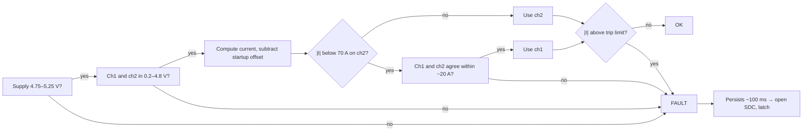

# BMS-Master

Controller board for the FSUK accumulator. Bridges to the daisy-chained
cell-monitor stack (`BMS-Module`, x6) via a BQ79600-Q1, runs the safety logic
(limit checks, SoC estimation, balancing control, fault latch), and talks two
CAN buses — full telemetry, and a summarized feed to the ECU/dashboard.

## Block diagram


- SPI to the **BQ79600-Q1 bridge** (plus `SPI_RDY` and `NFAULT` interrupts),
  reading the daisy-chained cell-monitor stack.
- Reads the accumulator **current sensor**.
- Runs **limit checks, SoC estimation, balancing control, fault latch**.
- Drives the **AMS fault relay** directly (not via CAN/ECU) — opens the SDC
  on fault, in both driving and charging states.
- **CAN1**: full telemetry (96 cells, 192 temps, balancing state, I, V).
  **CAN2**: summarized state (SoC, max cell V, max temp, fault code) to
  ECU/dashboard.
- Drives the **isolated charger regulation bus** (opto STOP signal).
- Watched by an **external watchdog** that opens the relay if the MCU hangs.

## MCU selection: STM32G474

Decision: **STM32G474** (fallback **STM32G473**, pin/feature-compatible — only
if G474 is out of stock).

Six other candidates also pass every must-have requirement (see verdict table
below), but G474 is the only one that also meets every nice-to-have: built-in
op-amps/PGAs, most ADCs, deepest CAN buffering.

### Requirements

| # | Requirement | Priority | Why |
|---|---|---|---|
| 1 | At least 2 CAN peripherals | Must | CAN1 = telemetry/diagnostics, CAN2 = ECU/dashboard. Classic CAN or CAN-FD both count. |
| 2 | CAN FD support | Nice | A 64 B CAN-FD frame needs ~7 frames per snapshot vs ~55 on classic CAN, but classic CAN at 1 Mbps already does a full snapshot in ~7 ms. Not a deciding factor. |
| 3 | SPI master for BQ79600-Q1 | Must | One SPI peripheral, plus `SPI_RDY` and `NFAULT` pins. |
| 4 | Hardware FPU | Must | SoC estimation algorithms. |
| 5 | RAM / Flash capacity | Must | Snapshot is ~420 B, plus limit tables, balancing state, fault latch, CAN queues. |
| 6 | Fast multi-channel ADC | Must | Hall-effect current sensor outputs an analog voltage proportional to current — the ADC reading is converted to a current value and feeds the overcurrent limit check directly (part of the fault-latch/AMS relay logic, not just telemetry). |
| 7 | Internal PGA / op-amp | Not needed | Confirmed: Hall-effect sensor (voltage output), not a raw shunt. No amplification needed before the ADC. |
| 8 | GPIO: 2 EXTI + relay, watchdog, opto outputs, switch input | Must | `SPI_RDY`, `NFAULT`, AMS relay, watchdog toggle, charger opto, balancing switch. |
| 9 | Deep CAN buffering (non-blocking TX) | Should | Telemetry must never block the safety path (relay, fault latch, watchdog). |

### Candidates evaluated

STM32G474, G473, G491, G431, H503, H523/H563, H723/H743, F446, F405, F413,
F429/F407, G0B1, F303 — spread across ST's current CAN-capable families, plus
F303 as a real precedent (ENNOID-BMS uses it, see
`Reference Docs/Open-Source BMS Projects/README.md`).

### Comparison matrix

| Requirement | Priority | G474 | G473 | G491 | G431 | H503 | H523/H563 | H723/H743 | F446 | F405 | F413 | F429/F407 | G0B1 | F303 |
|---|---|---|---|---|---|---|---|---|---|---|---|---|---|---|
| ≥2 CAN peripherals | Must | Meets | Meets | Meets | **Fails** | Verify | Meets | Meets | Meets | Meets | Meets | Meets | Meets | **Fails** |
| CAN FD support | Nice | Meets | Meets | Meets | Partial | Verify | Meets | Meets | Partial | Partial | Partial | Partial | Meets | Fails |
| SPI master for BQ79600-Q1 | Must | Meets | Meets | Meets | Meets | Meets | Meets | Meets | Meets | Meets | Meets | Meets | Meets | Meets |
| Hardware FPU | Must | Meets | Meets | Meets | Meets | Meets | Meets | Meets | Meets | Meets | Meets | Meets | **Fails** | Meets |
| RAM / Flash capacity | Must | Meets | Meets | Meets | Partial | Meets | Meets | Meets | Meets | Meets | Meets | Meets | Meets | Meets |
| Fast multi-channel ADC | Must | Meets | Meets | Meets | Meets | Meets | Meets | Meets | Meets | Meets | Meets | Meets | Partial | Meets |
| Internal PGA / op-amp | Nice | **Meets** | Meets | Partial | Meets | Fails | Fails | Fails | Fails | Fails | Fails | Fails | Fails | Verify |
| GPIO requirements | Must | Meets | Meets | Meets | Meets | Meets | Meets | Meets | Meets | Meets | Meets | Meets | Meets | Meets |
| Deep CAN buffering | Should | Meets | Meets | Meets | Meets | Meets | Meets | Meets | Partial | Partial | Partial | Partial | Meets | Partial |

Specs are from memory — verify CAN counts, ADC counts, and memory sizes in
CubeMX/datasheet before committing to silicon. H503's CAN count specifically
is unconfirmed.

### Verdict summary

| Variant | Must-haves (of 6) | Should/Nice (of 3) | Result | Verdict |
|---|---|---|---|---|
| **STM32G474** | 6/6 | 3/3 | Pass | **Recommended.** |
| STM32G473 | 6/6 | 3/3 | Pass | Same as G474. Fallback if out of stock. |
| STM32G491 | 6/6 | 2/3 | Pass | Fine with an external current sensor. |
| STM32G431 | 4/6 | 2/3 | Fail | Only one CAN. |
| STM32H503 | 5/6 | 1/3 | Fail | Check CAN count first. |
| STM32H523/H563 | 6/6 | 2/3 | Pass | Only worth it for a faster core or secure boot. |
| STM32H723/H743 | 6/6 | 2/3 | Pass | Overkill, big packages. |
| STM32F446 | 6/6 | 0/3 | Pass | Best F4 choice. Classic CAN is enough. |
| STM32F405 | 6/6 | 0/3 | Pass | Works. |
| STM32F413 | 6/6 | 0/3 | Pass | Works, 3x CAN. |
| STM32F429/F407 | 6/6 | 0/3 | Pass | Works, oversized. |
| STM32G0B1 | 4/6 | 2/3 | Fail | No FPU. Minimal-cost option only. |
| STM32F303 | 5/6 | 0/3 | Fail | Only one CAN, shared with USB packet SRAM. |

### Why G474 over the other passing candidates

- G474 has the most ADCs of any candidate — reads the Hall-effect current
  sensor with margin to spare.
- F4 family CAN buffering is 3 TX mailboxes (needs a software TX queue to
  avoid blocking the safety path); G474's FDCAN has message RAM instead.
- H7 and the larger F4 parts (F429/F407, F413) pass everything too, but are
  bigger/pricier for no benefit here.
- G473 = same silicon family, same analog block, same CAN count. Fallback
  only, not a second option.

The built-in op-amps that several candidates lack (F4, H5, H7 families) are
not a factor either way — confirmed not needed, see requirement 7 above.

### Package

LQFP64 — enough pins for everything above, with spares for SWD/debug.

### Sources

- [Google Sheet — stm32_requirements_matrix](https://docs.google.com/spreadsheets/d/1AgWugIduUw6VQksLgAckyC9UT4bKEkQZ88cZwor0tiw/edit?usp=sharing)
- `Reference Docs/STM32 MCU/` — STM32G474xB/xC/xE datasheet (DS12288)
- `Reference Docs/BQ796xx BMS/` — BQ79600-Q1 datasheet and app notes
- `Reference Docs/Open-Source BMS Projects/README.md` — real-world STM32 MCU precedent
- `Reference Docs/Current Sensor/` — LEM DHAB S/124 datasheet (the Hall-effect current sensor referenced in requirements 6-7 above)

## CAN transceiver selection

**v1 (this prototype): TCAN1042V-Q1** (SOIC-8, `TCAN1042VDRQ1`, LCSC `C485806`),
on both CAN1 and CAN2. VIO tied to the 3.3V rail (same rail as the STM32) for
direct 3.3V logic interfacing; VCC on the existing 5V rail.

**v2 (target): TCAN1462V-Q1.** This was the original pick — see rationale
below — but as of this prototype, LCSC (the team's only supplier) has the
SOIC-8 `TCAN1462VDRQ1` out of stock, with only the VSON-8 `TCAN1462VDRBRQ1`
(leadless, needs reflow/hot air) in stock. v1 is hand-soldered, so v1 uses
TCAN1042V-Q1 instead — fully valid, same vendor, same AEC-Q100 grade, same
Functional Safety documentation, just without SIC. **Check LCSC stock for
SOIC-8 `TCAN1462VDRQ1` before starting v2**, and switch to it if available.

### Isolation: not required

Checked against the actual rulebooks (`Reference Docs/FSUK Rules/`), not
assumption. FSG rule **EV 4.3.1**: "The entire TS and LVS must be galvanically
isolated" — this is a TS↔LVS boundary rule. Both CAN buses here are LVS-side
only (STM32 ↔ ECU/dashboard), already downstream of the one isolation
boundary that matters: the transformer-coupled daisy-chain link to the
BQ79600-Q1. Searched both rulebooks fully for "isolat"/"galvanic" — every
instance concerns the TS/LVS boundary (EV4.3.1) or component-level cases
(EV5.6.3, AIRs), never CAN. Confirmed by checking `FSAE_LSU_BMS` (a real FSAE
team's repo): their CAN nets are literally named `ISO_CAN1+/-`, but there's no
isolator component anywhere in their schematics or BOM — the name doesn't
mean what it implies.

### Requirements and candidates

| Requirement | Why |
|---|---|
| 3.3V logic (VIO) | Must interface directly with the STM32G474's 3.3V GPIO, no external level shifter. |
| Automotive-grade (AEC-Q100) | Board sees vibration, heat near HV equipment, and electrical noise — not a bench/lab environment. |

Four candidates compared, specs pulled directly from each manufacturer's
datasheet (`Reference Docs/CAN Transceivers/`):

| | TCAN1462V-Q1 | TCAN1042V-Q1 | TJA1057 | MCP2562FD |
|---|---|---|---|---|
| VCC / VIO | 4.5-5.5V / 1.7-5.5V | 4.5-5.5V / 3.3V or 5V | 4.5-5.5V / 2.91-5.5V | 4.5-5.5V / 1.8-5.5V |
| Max data rate | 8 Mbps (CAN FD + SIC) | 2 Mbps (5 Mbps "G" suffix) | 5 Mbps (all but "T" variant) | 8 Mbps (CAN FD) |
| Bus fault tolerance | ±58V | ±58V (±70V "H" variant) | ±42V | Not confirmed |
| AEC-Q100 | Grade 1, confirmed | Grade 1, confirmed | Qualified, confirmed | **Not in datasheet** — marketing language only |
| Functional Safety docs | Yes | Yes | No | No |
| Distinguishing feature | SIC — reduces ringing on multi-stub topologies | Direct TI/BQ79616 precedent | — | — |

### Why TCAN1462V-Q1 over TCAN1042V-Q1 (the v2 reasoning)

Both are fully valid (same vendor, same AEC-Q100 grade, same Functional
Safety documentation). TCAN1462V-Q1 was chosen for **SIC** (Signal
Improvement Capability) — actively reduces bus ringing in networks with
multiple unterminated stubs, which fits a car harness with several CAN nodes
(BMS-Master, ECU, dashboard) branching off rather than a clean daisy chain.
MCP2562FD was ruled out for lacking confirmed AEC-Q100 qualification.
TJA1057 is AEC-Q100 qualified but has no Functional Safety documentation and
no SIC — ruled out in favor of staying in the same TI ecosystem as the rest
of the signal chain (BQ79600-Q1 → BQ79616 → CAN transceiver). v1 uses
TCAN1042V-Q1 instead purely for hand-solder package/stock availability, not
because the SIC reasoning changed.

### Sources

- `Reference Docs/CAN Transceivers/` — datasheets for all four candidates
- `Reference Docs/FSUK Rules/` — FSUK and FSG rulebooks (isolation requirement check)
- `Reference Docs/Open-Source BMS Projects/FSAE_LSU_BMS/` — real-world CAN wiring reference (and the `ISO_CAN` naming caveat above)

## Daisy-chain isolation transformer selection

**Decision: Bourns SM91502ALE**, on both ends of every daisy-chain link: the
BQ79600-Q1 side on this board and COMH/COML on every `BMS-Module`.

On this board the transformer is the TS/LV isolation barrier: the BQ79600-Q1
and STM32 are LV, and everything past the transformer is TS. Between modules
it only isolates TS from TS (one module's voltage, ~67 V).

### TI's validated list

The BQ79616 datasheet points to SLVAEP4 (BQ79616-Q1 Daisy Chain
Communications) for transformer parts. Table 5-1 lists the parts TI tested
with the BQ7961x:

| Part | Supplier | Inductance (OCL) | Height |
|---|---|---|---|
| HMU1228NL | Pulse | 150–370 µH | 6.85 mm |
| HM2147NL | Pulse | 580–1285 µH | 3.45 mm |
| SM91502AL | Bourns | 150–450 µH | 5.72 mm |

TI's rules from the same section:

1. Prefer parts in the **150–600 µH** range.
2. Use the **same part number on both ends** of every link (COML of the upper
   device and COMH of the lower one).
3. Anything **off this list** needs your own system-level validation over
   temperature, fast transactions and EMI.

Only parts on this list were considered.

### Rule check (max TS voltage 403 V)

The FSG 2026 rules (used by FSUK) apply to the transformer on this board,
because it is the TS/LV barrier:

- **EV 1.2.1 — galvanic isolation.** The AC test voltage (RMS, 1 min) must be
  above 3 × max TS voltage or 750 V, whichever is higher: **> 1209 Vrms**. The
  barrier's working voltage, if specified, must be above max TS voltage:
  **> 403 V**.
- **EV 4.3.6 — TS and LV on the same PCB.** At 300–600 V: **3.0 mm clearance**,
  and **20 mm creepage**, or **4.0 mm with conformal coating**.

### Candidates compared

All values from each part's datasheet in `Reference Docs/BMS Isolation Transformers/`.

| | **SM91502AL** (Bourns) | HMU1228NL (Pulse) | HM2147NL (Pulse) |
|---|---|---|---|
| Inductance (OCL) | 150–450 µH | 150–370 µH | 500 µH min (TI: 580–1285 µH) |
| Inside TI's 150–600 µH window | **Yes** | Yes | **No** |
| Height | 5.72 mm | 6.85 mm | 3.45 mm |
| Hipot, primary to secondary | 4300 VDC, 1 mA, 60 s | 4300 VDC, 60 s | 4300 Vrms, 60 s |
| Working voltage | 1000 VDC | 1000 VDC | 1500 VDC |
| Insulation grade | Functional | **Basic** | Functional |
| Creepage / clearance (part) | Not stated | **10 mm / 7 mm** | >3 mm / not stated |
| Operating temp | −40 to +125 °C | −40 to +125 °C | −40 to +125 °C |
| AEC-Q200 | Yes | Not stated | Yes |
| Built-in common-mode choke | Yes | Yes (1CT:1CT) | No |
| TI reference design | — | TIDA-010271 | — |

All three pass EV 1.2.1. The working voltage is above 403 V for all three.
The hipot needs one line of explanation for the two VDC-rated parts: a
4300 VDC test stresses the barrier to 4300 V peak, the same as a ~3040 Vrms AC
test, which is well above the 1209 Vrms required.

### Why SM91502AL

- **Inside TI's preferred inductance range.** 150–450 µH sits in the middle of
  the 150–600 µH window. HM2147NL is above it.
- **AEC-Q200 compliant**, rated −40 to +125 °C.
- **Lower than the HMU1228NL** (5.72 mm vs 6.85 mm). There are two transformers
  on each of six module boards inside the TSAC.
- **Common-mode choke built in**, so no separate choke is needed on the link.
- **Second source with the same footprint:** the CND-tek CB0603S has the same
  package dimensions and land pattern (check the pinout), 150–370 µH, 4300 VDC hipot, 1000 VDC working
  voltage, and states >5 mm creepage. It is **not** on TI's list, so treat it
  as a fallback that needs its own validation, not a drop-in.

### Caveats

- **Functional insulation, creepage not stated.** The SM91502AL datasheet
  rates the construction as "Functional insulation" and gives no creepage or
  clearance figure. EV 1.2.1 doesn't require a particular insulation grade,
  but if the scrutineer or ESA wants a Basic-rated barrier with stated
  spacing, the **HMU1228NL** (Basic, 10 mm creepage, TIDA-010271 precedent) is
  the fallback. Raise this with the ESA before ordering.
- **PCB spacing is a layout job.** On this board the two pad rows of the
  transformer are the TS/LV boundary. Reading the recommended land pattern as
  a 7.11 mm row pitch with 2.54 mm pads gives roughly **4.5 mm** between the
  rows. Measure it on the real footprint in Altium. That would meet 4.0 mm
  with conformal coating and the 3.0 mm clearance, but not 20 mm uncoated. **This board needs conformal coating**, or a slot under the
  transformer. Mark the TS and LV areas on the silkscreen, as EV 4.3.6
  requires.
- **Same part on both ends.** With identical module boards this is automatic.
  Note it on the schematic so nobody substitutes a different transformer on
  one board later.
- **Ordering code.** `SM91502ALE` = SM91502, A (AEC-Q200), L (Cu/Ni/Sn
  termination), E (tape and reel, 800 pcs/reel).

### Sources

- `Reference Docs/BQ796xx BMS/Application Notes/BQ79616-Q1 Daisy Chain Communications (slvaep4).pdf` — Section 5.1, Table 5-1
- `Reference Docs/BMS Isolation Transformers/` — datasheets for SM91502AL, HMU1228NL, the Pulse BM101 family (HM2147NL), and CND-tek CB0603S
- `Reference Docs/BQ796xx BMS/TIDA-010271 Reference Design/` — uses HMU1228NL
- `Reference Docs/FSUK Rules/FSG-Rules_2026_v1.1.pdf` — EV 1.2.1, EV 4.3.6 and Table 5

## Current sensor selection

**Decision: LEM DHAB S/124** (dual-channel open-loop Hall, analog output),
around the 18 mm orange TS cable inside the TSAC. **Pending:** FSUK's written
confirmation of the isolation argument below, before the Master layout is
frozen.

### What the rules require

| Rule | Requirement | Consequence |
|---|---|---|
| EV 5.8.2 | Full AMS inside the TSAC | Sensor and Master both inside the TSAC |
| EV 5.8.3 | AMS continuously measures TS current | This sensor |
| EV 5.8.10 | Open SDC if current exceeds a critical value for > 500 ms, accounting for accuracy and noise | Trip threshold includes the sensor error margin |
| EV 5.8.13, T 11.9 | AMS signals are System Critical Signals: open circuit, short to GND, short to supply and implausible values must give a safe state | Firmware fault checks, see below |
| EV 5.8.14 | Each monitored value's fault must be triggerable at inspection | Unplugging the sensor connector trips the AMS |
| EV 2.2.1 / 2.2.2 | Max 80 kW, max 500 A at the TSAC outlet | ~200 A at 403 V full pack, ~330 A at 240 V empty, 500 A peak |
| T 11.6.9 | BSPD and its sensors outside the TSAC | The BSPD needs its own current sensor; it cannot share this one |
| EV 1.2.1 | Anything crossing TS/LV is an isolation barrier | See isolation section |

### How it works

1. **Current makes a magnetic field.** The pack current in the cable creates
   a field circling it, proportional to the current.
2. **A core collects the field into a gap.** A magnetic ring around the cable
   gathers the field. All of it has to cross one small air gap, so the field
   in the gap is strong and proportional to the current
   (B<sub>gap</sub> ≈ μ₀·I / g).

   

   There are two cores side by side, one per channel. Channel 1 (FeNi core,
   ±75 A) gives fine resolution near zero. Channel 2 (FeSi core, ±500 A)
   covers full power.

3. **The Hall chip turns field into voltage.** A small constant current flows
   through a thin semiconductor plate. The field pushes the charges to one
   edge, creating a voltage across the plate proportional to the field, so
   to the cable current.

   

4. **The ASIC amplifies and trims it** to a ratiometric output: 2.5 V at 0 A,
   moving up or down with current, always clamped between 0.25 V and 4.75 V
   while the sensor works.

```
Uout = (UC / 5) · (S · IP + 2.5)      ⇒      IP = (5 · Uout / UC − 2.5) / S
```

| Channel | Range | Sensitivity S | Output at full range | Used for |
|---|---|---|---|---|
| 1 (FeNi) | ±75 A | 26.7 mV/A | 0.50 / 4.50 V | Low current, charging, SoC |
| 2 (FeSi) | ±500 A | 4 mV/A | 0.50 / 4.50 V | Full power, overcurrent trip |

Supply 5 V ±5% (20 mA max), bandwidth 70 Hz, load ≥ 10 kΩ and ≤ 100 nF,
connector TE 1-1456426-5 (A = 5 V, B = high range, C = GND, D = low range).

### Interface to the Master

Each output goes through a 12 kΩ / 18 kΩ divider (×0.6) to an STM32 ADC pin.
The sensor's 5 V supply is measured on a third channel with the same divider,
because the output is ratiometric.


- 4.75 V max → 2.85 V at the pin; a short to 5 V → 3.0 V, so the two are distinguishable.
- The 18 kΩ bottom resistor pulls a broken wire to 0 V, which the range check catches.
- 30 kΩ total load, above the 10 kΩ minimum.
- Resolution: ~0.05 A/LSB on channel 1, ~0.34 A/LSB on channel 2, finer than the sensor error.

### Fault detection (T 11.9)

At startup the AIRs are open, so the true current is 0 A. The firmware checks
the supply, checks both channels are in range, checks both read ~0 A, and
stores the offset. Only then does the AMS report OK.

Every sample (~1 kHz) while running:



The channel is chosen from channel 2's reading because above ~84 A channel 1
sits at its 4.75 V clamp, which still looks valid.

| Failure | What the ADC sees | Caught by |
|---|---|---|
| Signal wire broken | 0 V (pull-down) | Range check |
| Signal short to GND | 0 V | Range check |
| Signal short to 5 V | 5.0 V | Range check |
| Sensor supply lost | 0 V, supply monitor low | Supply + range check |
| Sensor GND broken | Probably high | Range check, **to be confirmed on the bench** |
| Stuck at a valid value | In range | Startup zero check, ch1/ch2 plausibility |
| Connector unplugged | 0 V on both | Range check (this is the inspection test) |

### Accuracy

Worst-case total error from the datasheet:

| | −40 °C | 25 °C | 125 °C |
|---|---|---|---|
| Ch1 at 0 A | ±0.35 A | ±0.15 A | ±0.35 A |
| Ch1 at ±75 A | ±2.50 A | ±1.30 A | ±2.50 A |
| Ch2 at 0 A | ±1.80 A | ±1.00 A | ±1.80 A |
| Ch2 at ±500 A | ±15.0 A | ±9.0 A | ±15.0 A |

The overcurrent trip is set to the cell limit minus channel 2's error
(e.g. 450 A cell limit → 435 A trip), so a sensor reading low can never hide
a real overcurrent (EV 5.8.10).

### Isolation (EV 1.2.1)

The copper is at TS voltage; the Hall chip and its wires are LV. Under a
single insulation fault the cable can sit the full 403 V from LV ground. There
are two barriers in series between them:


| EV 1.2.1 (max TS 403 V) | Sensor housing alone | Orange cable insulation |
|---|---|---|
| Insulation resistance ≥ 500 Ω/V (≥ 0.2 MΩ) | 500 MΩ at 500 V ✅ | Not in datasheet, measure with a megger |
| Test voltage > 3 × 403 = 1209 V, 1 min | 2.5 kV ✅ | 2500 V ✅ |
| Working voltage, if stated, > 403 V | **UL 300 V ❌** | 600 V nominal ✅ |

The sensor housing on its own fails on paper: its UL 508 rating is 300 V, and
scrutineers check this line per component (FSCZ 2025 EV inspection sheet,
items 34–35). With a bare busbar this would rule the DHAB out. With an
insulated cable, the argument is that **the 600 V-rated cable insulation is
the isolation barrier and the sensor never touches TS potential**; the housing
is a second layer. This is our interpretation, so it needs FSUK's written
confirmation.

The cable is Jainson NBR rubber welding cable, orange (`Reference Docs/TS
Cable/`): 600 V nominal, 2500 V test, −30 to +90 °C, which also meets EV 4.5.2
(insulation rated for max TS voltage) and EV 4.5.3 (≥ 85 °C). The datasheet
doesn't say whether 600 V is AC or DC.

### Mounting

The sensor hole is Ø 22.5 mm with one flat side 21.55 mm across; the cable
measures 18 mm. Fill the ~2 mm gap with a sleeve or split grommet so the cable
stays centred, and clamp the cable on both sides (EV 4.3.5; an open-loop
sensor's reading shifts slightly if the conductor moves in the hole).

### Alternatives considered

| | DHAB S/124 | LEM CAB 500-C/SP5 | LEM CAB-SF 500-C/SP1 | Isabellenhütte IVT-S | Amphenol HCSO-1WD 75/500 |
|---|---|---|---|---|---|
| Voltage rating | UL 300 V | UL 600 V | Not stated | 1000 V basic (IEC 60664) | Not stated |
| Insulation test | 2.5 kV | 2.5 kV | 2.5 kV | — | Not stated |
| Creepage | 3.1 mm | 7.2 mm | 7.2 mm | — | 3.95 mm |
| Output | Analog, 2 ch | CAN | CAN + CRC + counter, ASIL B | CAN | Analog, 2 ch |
| Supply | 5 V | 12 V | 12 V | 12/24 V | 5 V |

The CAN sensors avoid the 300 V question entirely but change the Master
design (third CAN bus instead of ADC inputs, CAN timeout/CRC checks instead of
range checks). They are the fallback if FSUK rejects the cable-insulation
argument. The HCSO-1W is electrically almost identical to the DHAB but its
datasheet gives no insulation figures at all.

### Open items

1. Read the cable type from its jacket printing: 18 mm matches both the
   double-insulated NBR/NBR 70 mm² (18.7 mm) and the single NBR 95 mm²
   (18.2 mm). Needed for EV 4.5.5 anyway.
2. Ask FSUK (rules Q&A) to confirm the cable insulation as the barrier for
   the DHAB S/124, naming the cable as welding cable.
3. Megger the cable-through-sensor assembly at 500/1000 V DC, and hipot it
   above 1209 Vrms (or ~1710 V DC) for 60 s, copper to all four sensor pins.
   Results and photos go in the ESF.
4. Bench calibration with N turns of wire through the hole (N × I looks like
   N × the current), both channels, both directions.
5. Fault-injection test for every row of the fault table, recording that the
   AMS opens the SDC in under 500 ms (T 11.9.7).

### Sources

- `Reference Docs/Current Sensor/` — DHAB S/124 (v5), CAB-SF 500-C/SP1, HCSO-1W datasheets
- `Reference Docs/TS Cable/Jainson NBR Welding Cable Datasheet.pdf`
- `Reference Docs/FSUK Rules/` — FSG 2026 v1.1 (EV 1.2.1, EV 2.2, EV 4.3.5, EV 4.5, EV 5.8, T 11.6, T 11.9) and FSUK 2026 supplementary
- [LEM CAB 500-C/SPx datasheet v4](https://www.lem.com/sites/default/files/products_datasheets/cab_500-c_spx_public_datasheet_v4.pdf), [Isabellenhütte IVT-S datasheet](https://www.isabellenhuette.com/hubfs/Files/Data-sheets/IVT-S.pdf?hsLang=en)
- [FS Czech 2025 EV inspection sheet](https://fsczech.cz/wp-content/uploads/2025/07/FSCZ25_InspectionSheet_EV.pdf) — isolation barrier checks
- [FSN 2022 accumulator inspection checklist](https://www.formula-student.nl/wp-content/uploads/2022/07/FSN-2022-Scrutineering-System-Accu-Inspection-Master.pdf) — current sensor disconnect test
