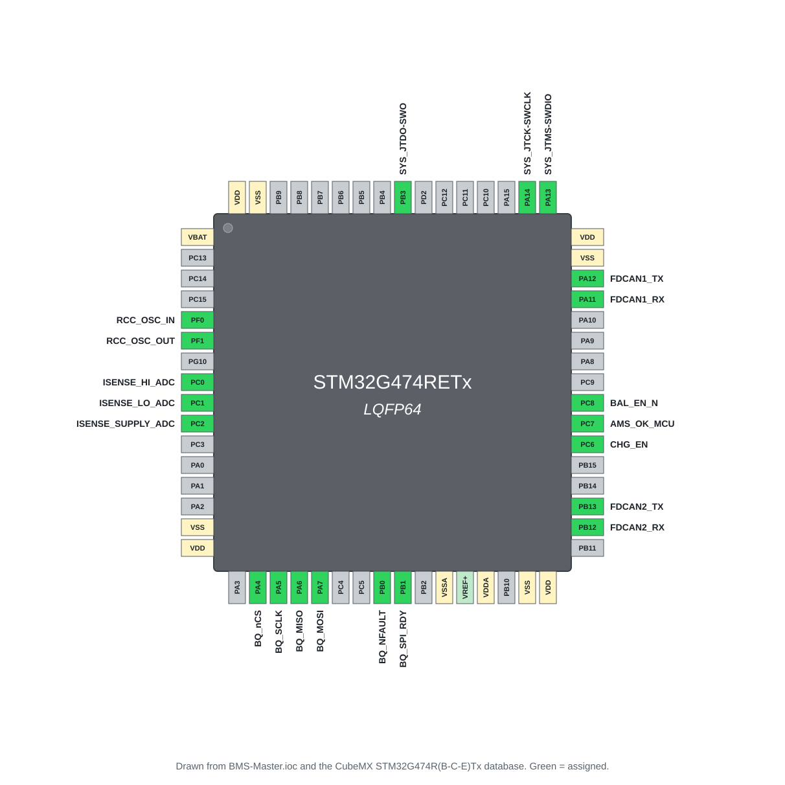

# Firmware

| Project | MCU | Board |
|---|---|---|
| [`BMS-Master/`](BMS-Master/) | STM32G474RET6 (LQFP64) | [`BMS-Master`](../BMS-Master/README.md) |

## BMS-Master

STM32CubeIDE project generated by STM32CubeMX 6.18.1 with STM32Cube FW_G4
V1.6.3. The configuration lives in [`BMS-Master/BMS-Master.ioc`](BMS-Master/BMS-Master.ioc);
open it in CubeMX to change pins, clocks or peripherals, then click
Generate Code. Only code inside `/* USER CODE BEGIN ... */` /
`/* USER CODE END ... */` blocks survives regeneration.



Drawn from `BMS-Master.ioc` and the CubeMX pin database (`docs/pinout.svg`). The same
configuration in the CubeMX window: [`docs/cubemx-pinout.png`](docs/cubemx-pinout.png).

### Pins

| Pin | Function | Label (`main.h`) | Net on the schematic |
|---|---|---|---|
| PA13 / PA14 / PB3 | SWDIO / SWCLK / SWO (Trace Asynchronous SW) | | J4 via `SWD` harness |
| NRST | reset | | `MCU_NRST` |
| PF0 / PF1 | HSE, 20 MHz crystal | | `MCU_OSC_IN` / `MCU_OSC_OUT` |
| PA11 / PA12 | FDCAN1 RX / TX | | CAN1 `CAN_MCU` |
| PB12 / PB13 | FDCAN2 RX / TX | | CAN2 `CAN_MCU` |
| PA5 / PA6 / PA7 | SPI1 SCK / MISO / MOSI | `BQ_SCLK` / `BQ_MISO` / `BQ_MOSI` | `BQ97600_SPI` |
| PA4 | GPIO out, starts high | `BQ_nCS` | `BQ97600_SPI` nCS |
| PB0 | EXTI0, falling edge | `BQ_NFAULT` | `BQ97600_SPI` NFAULT |
| PB1 | GPIO in | `BQ_SPI_RDY` | `BQ97600_SPI` nUART/SPI (SPI_RDY) |
| PC0 / PC1 / PC2 | ADC1 IN6 / IN7 / IN8 | `ISENSE_HI_ADC` / `ISENSE_LO_ADC` / `ISENSE_SUPPLY_ADC` | `ISENSE_ADC` |
| PC6 | GPIO out, starts low | `CHG_EN` | `CHG_EN` |
| PC7 | GPIO out, starts low | `AMS_OK_MCU` | `AMS_OK_MCU` |
| PC8 | GPIO in | `BAL_EN_N` | `BAL_EN_N` |

Avoid PB8 (BOOT0). Every pin was checked against the CubeMX MCU database.

### Settings

| | Setting | Why |
|---|---|---|
| Clock | HSE 20 MHz / 5 × 85 / 2 = **170 MHz**, voltage scale 1 boost, flash latency 4 | Maximum for the G474 |
| FDCAN1, FDCAN2 | Classic CAN, **500 kbit/s**: PCLK1 170 MHz, prescaler 17, Seg1 16, Seg2 3, SJW 3 (sample point 85 %) | Confirm the bit rate with the car's CAN bus |
| SPI1 | Master, mode 0 (CPOL 0, CPHA 0), 8-bit, MSB first, **5.3 MHz** (÷32), software nCS, pins at **medium** speed | BQ79600-Q1: data captured on the rising edge, SCLK 2–6 MHz. Low speed is only rated to 5 MHz at 50 pF (DS12288 Table 56), medium to 25 MHz |
| ADC1 | IN6, IN7, IN8 regular scan, software trigger, 12-bit, **247.5-cycle sampling** (5.8 µs), clock PCLK ÷ 4 = 42.5 MHz | IN6–IN8 are slow channels. The divider's Thevenin resistance is 12k ∥ 18k = 7.2 kΩ; DS12288 Table 67 allows 3.9 kΩ at 92.5 cycles but 10 kΩ at 247.5, so the sampling is correct even without the 100 nF at the pin. A 3-channel scan still takes about 18 µs. Run `HAL_ADCEx_Calibration_Start` after power-up (DS12288 recommends it) |
| NVIC | EXTI0 (NFAULT), FDCAN1_IT0, FDCAN2_IT0 enabled | |
| Project | STM32CubeIDE, generated under root, one .c/.h per peripheral, only needed library files copied | Builds with 0 errors, 0 warnings |

### Build

Open the folder in STM32CubeIDE (File > Import > Existing Projects into
Workspace, don't copy into the workspace), or build headless:

```
stm32cubeidec.exe --launcher.suppressErrors -nosplash -application org.eclipse.cdt.managedbuilder.core.headlessbuild -data <workspace> -import <path>\Firmware\BMS-Master -build BMS-Master/Debug
```

Build output (`Debug/`, `Release/`) is git-ignored.
