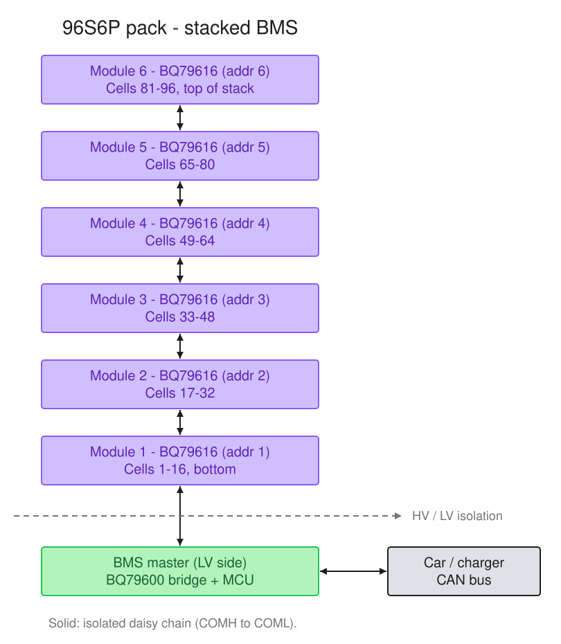

# FSUK-BMS

BMS (AMS in the FSUK rules) for a Formula Student UK electric car.

- Pack: 96S6P, 403 V max.
- `BMS-Module` (×6): BQ79616, 16 cells each, cell voltages, temperatures, balancing.
- `BMS-Master` (×1): BQ79600 + STM32G474 on the LV side.

## Block diagram



- The modules are connected in an isolated daisy chain (transformer-coupled
  twisted pair), addresses 1–6. Module 1 = cells 1–16, module 6 = cells 81–96.
- On the master, the BQ79600 bridges the daisy chain to SPI for the STM32.
- The STM32 also reads the pack current (LEM DHAB S/124).
- Outputs from the master:
  - `AMS_OK` (12 V) to the SDC board. Low opens the SDC.
  - CAN1: full telemetry. CAN2: summary to the ECU/dashboard.
  - Charger stop signal on the Reg Bus (opto-isolated).
- TS/LV isolation points: daisy-chain transformer, current sensor, charger opto.

## Boards

| Board | Main parts | Status | Docs |
|---|---|---|---|
| `BMS-Master` | STM32G474, BQ79600-Q1, 2× TCAN1042, DHAB S/124 input, `AMS_OK` driver, charger interface, 12 V → 6.5 V → 5 V / 3.3 V | Schematic in progress | [README](BMS-Master/README.md), [schematic PDF](BMS-Master/BMS-Master_Schematics.pdf) |
| `BMS-Module` | BQ79616, cell sense filters, balancing, thermistor mux, daisy chain | Schematic in progress | [schematic PDF](BMS-Module/BMS-Module_Schematics.pdf) |

Design decisions are documented in each board's `README.md` (one `##`
section per decision). `BMS-Module` has no README yet.

## Repo layout

```
FSUK-BMS/
├── BMS-Master/       Altium project: master board
│   ├── Sheets/       Schematic sheets (Top.SchDoc = overview)
│   ├── docs/         README images
│   └── sim/          LTspice simulations
├── BMS-Module/       Altium project: module board
├── Docs/             Git for Altium guide, block diagram
└── Reference Docs/   Datasheets, app notes, rules (Shared/, Master/, Module/);
                      start with Reference Docs/README.md
```

`BMS-Master` and `BMS-Module` are separate Altium projects. Open each one on
its own (no shared workspace file).

## One-time setup (do this before opening anything in Altium)

1. Install [Git](https://git-scm.com/downloads).
2. Install [Git LFS](https://git-lfs.com/) — this repo stores all the Altium
   design files (`.SchDoc`, `.PcbDoc`, `.SchLib`, `.PcbLib`) and PDFs through it,
   because they're binary files and regular git handles those very badly.
3. Install [TortoiseGit](https://tortoisegit.org/) — gives you Git through
   right-click menus in File Explorer, no command line needed.
4. Clone this repo (see below), then in the cloned folder run once:
   ```
   git lfs install
   git lfs pull
   ```
   Check that the `Sheets\` folders contain `.SchDoc` files before opening
   Altium. If Altium says sheets are "missing", see **Troubleshooting** in
   `Docs/GIT_FOR_ALTIUM.md`.
5. Set your Git name/email and sign in to GitHub — see step 2 of
   `Docs/GIT_FOR_ALTIUM.md`.

Use TortoiseGit or the command line for all Git operations — **not** Altium's
built-in Git support, which doesn't handle Git LFS.

## Why Git LFS + file locking (read this before editing anything)

Altium files (`.SchDoc`, `.PcbDoc`, `.SchLib`, `.PcbLib`) are **binary** — unlike
code, Git cannot merge two people's edits to the same file. If you and a
teammate both edit `Top.SchDoc` at the same time and both push, one of you will
have to throw away your changes and redo them.

To prevent that, these file types are set up as **"lockable"** in this repo.
Before editing one of them, you lock it — this reserves it for you and makes it
read-only for everyone else until you unlock it. See the workflow section below.

## Day-to-day workflow

1. **Pull** the latest changes before you start working.
2. **Lock** the specific file(s) you're about to edit.
3. Edit in Altium, save.
4. **Run the project's Output Job** (`BMS-Master.OutJob` / `BMS-Module.OutJob`,
   visible in the Projects panel) to regenerate the schematic PDF — right-click
   it → **Run**. First time you run it, Altium may ask where to save the PDF;
   point it at a `Project Outputs` folder inside the project (already
   git-ignored) and it'll remember that choice afterwards.
5. **Commit** with a short message describing what changed (include the
   regenerated PDF in the commit).
6. **Push.**
7. **Unlock** the file(s) so someone else can edit them next.

The Output Job means anyone can open the latest schematic PDF straight from
GitHub without needing Altium installed — handy for reviewing on a phone/
laptop that doesn't have it.

See `Docs/GIT_FOR_ALTIUM.md` for the exact TortoiseGit click-by-click steps.
